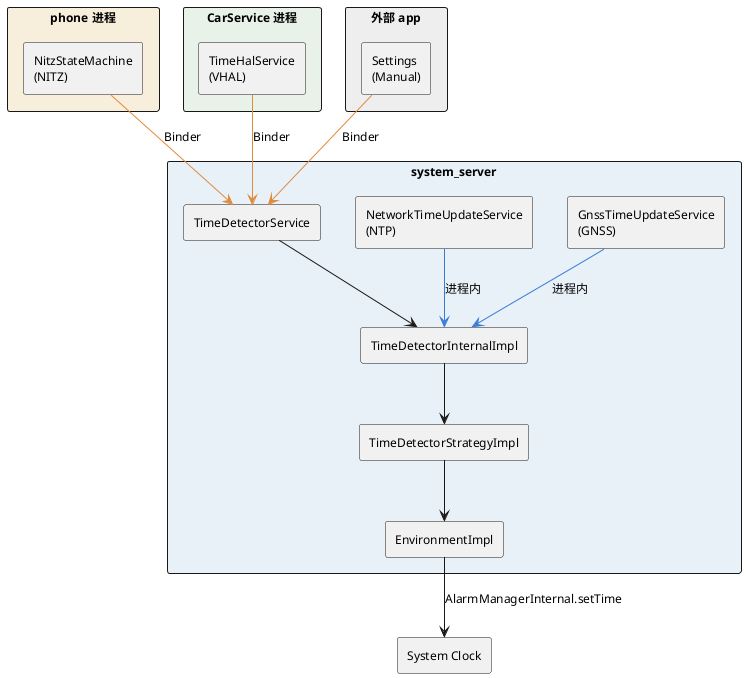
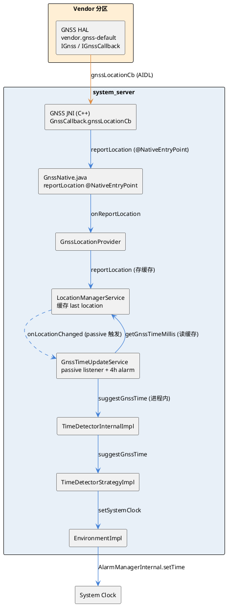
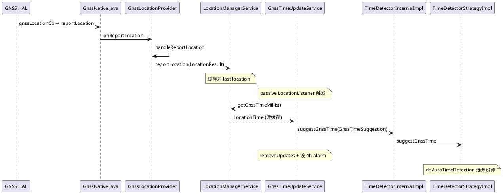
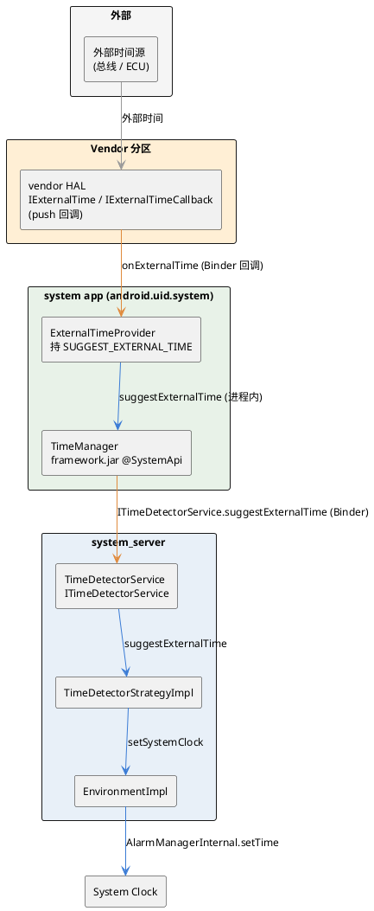
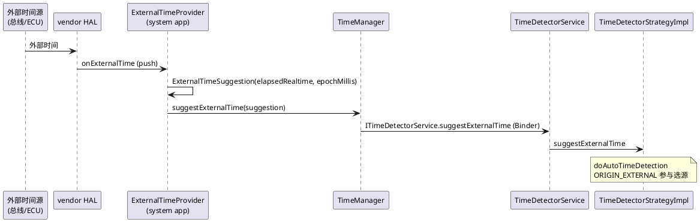
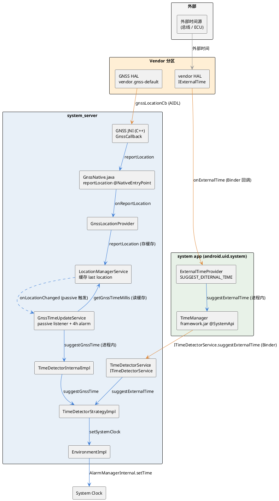

## 1 前言

AOSP的时间检测由`TimeDetectorService`统一管理,多个时间源各自向其提交时间建议,策略层按优先级选出最佳源设置系统时钟.本文基于原生AOSP(Android 16)源码,先从整体模块和进程的角度梳理架构,再以GNSS通路为例分析完整的调用逻辑.范围限于时间检测(time detection),不涉及timezone检测.

## 2 整体架构

### 2.1 模块与进程

时间检测相关的代码分散在几个进程里,核心逻辑集中在system_server的`services.core`库.

| 模块 | 进程 | 分区 | 代码来源 |
|------|------|------|----------|
| `TimeDetectorService`/`TimeDetectorInternalImpl`/`TimeDetectorStrategyImpl`/`EnvironmentImpl` | system_server | system | services.core (timedetector) |
| `GnssTimeUpdateService`/`NetworkTimeUpdateService` | system_server | system | services.core (timedetector) |
| `GnssNative`/`GnssLocationProvider`/`LocationManagerService` | system_server | system | services.core (location) |
| `NitzStateMachineImpl` | phone (com.android.phone) | system | telephony-common |
| `TimeHalService` | CarService (com.android.car.updatable) | system | packages/services/Car |
| GNSS HAL | vendor.gnss-default | vendor | hardware/interfaces/gnss |

`services.core`、`framework.jar`、`telephony-common`、`CarService`都在system分区,GNSS HAL在vendor分区.原生AOSP没有system_ext的时间组件,也没有厂商定制的时间HAL,GNSS HAL只是`hardware/interfaces/gnss/aidl/default/`下的参考实现.

### 2.2 时间源与入口

策略层定义了五个时间源,用`@Origin`标注的整型常量表示.

```java
// TimeDetectorStrategy.java
@IntDef({ ORIGIN_TELEPHONY, ORIGIN_MANUAL, ORIGIN_NETWORK, ORIGIN_GNSS, ORIGIN_EXTERNAL })
@Retention(RetentionPolicy.SOURCE)
@interface Origin {}

@Origin int ORIGIN_TELEPHONY = 1;  // NITZ
@Origin int ORIGIN_MANUAL = 2;     // 用户手动
@Origin int ORIGIN_NETWORK = 3;    // NTP
@Origin int ORIGIN_GNSS = 4;       // GNSS
@Origin int ORIGIN_EXTERNAL = 5;   // 外部
```

入口方式分为两类,这是整个架构的关键.system_server内部的源(GNSS、Network)产生建议后,直接通过`TimeDetectorInternal`这个进程内接口提交,`suggestGnssTime`和`suggestNetworkTime`都不在`ITimeDetectorService`的AIDL里,因为它们不需要跨进程.其他进程的源(Telephony在phone进程、External在CarService进程、Manual来自外部app)必须跨进程,经`framework.jar`里的`TimeManager`或`TimeDetector`走Binder到`ITimeDetectorService`.

| 常量 | 源 | 入口进程 | 入口方式 |
|------|----|---------|---------|
| `ORIGIN_TELEPHONY` | NITZ | phone | Binder |
| `ORIGIN_MANUAL` | 用户手动 | 外部app | Binder |
| `ORIGIN_NETWORK` | NTP | system_server | 进程内 |
| `ORIGIN_GNSS` | GNSS | system_server | 进程内 |
| `ORIGIN_EXTERNAL` | 外部(CarService/VHAL) | CarService | Binder |

这也解释了建议类的分布.`GnssTimeSuggestion`和`NetworkTimeSuggestion`定义在`com.android.server.timedetector`,是server内部类,没有AIDL,不跨进程.`ExternalTimeSuggestion`、`TelephonyTimeSuggestion`、`ManualTimeSuggestion`定义在`android.app.time`或`android.app.timedetector`,是`@SystemApi`的Parcelable,带AIDL,用于跨进程传递.



### 2.3 框架API

framework.jar对外提供两套API,都委派给同一个`ITimeDetectorService` Binder.`TimeManager`是`@SystemApi`(包`android.app.time`),给外部和特权app用,提供`suggestExternalTime`、`setManualTime`、`confirmTime`以及配置查询.`TimeDetector`是`@hide`的`@SystemService`(包`android.app.timedetector`),给telephony这类内部组件用,提供`suggestTelephonyTime`、`suggestManualTime`.

`ITimeDetectorService`的AIDL方法有`getCapabilitiesAndConfig`、`updateConfiguration`、`getTimeState`、`confirmTime`、`setManualTime`、`suggestExternalTime`、`suggestManualTime`、`suggestTelephonyTime`、`latestNetworkTime`等,不含GNSS和Network的suggest方法.

### 2.4 决策与设钟

`TimeDetectorStrategyImpl`是决策核心.每次有新建议进来,都会触发`doAutoTimeDetection`重新选源.

```java
// TimeDetectorStrategyImpl.java
private void doAutoTimeDetection(@NonNull String detectionReason) {
    int[] originPriorities = mCurrentConfigurationInternal.getAutoOriginPriorities();
    for (int origin : originPriorities) {
        UnixEpochTime newUnixEpochTime = null;
        String cause = null;
        if (origin == ORIGIN_TELEPHONY) {
            TelephonyTimeSuggestion bestTelephonySuggestion = findBestTelephonySuggestion();
            if (bestTelephonySuggestion != null) {
                newUnixEpochTime = bestTelephonySuggestion.getUnixEpochTime();
                cause = "Found good telephony suggestion.";
            }
        } else if (origin == ORIGIN_NETWORK) {
            NetworkTimeSuggestion networkSuggestion = findLatestValidNetworkSuggestion();
            if (networkSuggestion != null) {
                newUnixEpochTime = networkSuggestion.getUnixEpochTime();
                cause = "Found good network suggestion.";
            }
        } else if (origin == ORIGIN_GNSS) {
            GnssTimeSuggestion gnssSuggestion = findLatestValidGnssSuggestion();
            if (gnssSuggestion != null) {
                newUnixEpochTime = gnssSuggestion.getUnixEpochTime();
                cause = "Found good gnss suggestion.";
            }
        } else if (origin == ORIGIN_EXTERNAL) {
            ExternalTimeSuggestion externalSuggestion = findLatestValidExternalSuggestion();
            if (externalSuggestion != null) {
                newUnixEpochTime = externalSuggestion.getUnixEpochTime();
                cause = "Found good external suggestion.";
            }
        }

        // 第一个拿到有效建议的源被采纳, 直接 return
        if (newUnixEpochTime != null) {
            if (mCurrentConfigurationInternal.getAutoDetectionEnabledBehavior()) {
                setSystemClockAndConfidenceIfRequired(origin, newUnixEpochTime, cause);
            } else {
                upgradeSystemClockConfidenceIfRequired(newUnixEpochTime, cause);
            }
            return;
        }
    }
}
```

`doAutoTimeDetection`按`originPriorities`的顺序逐个尝试,第一个拿到有效建议的源就被采纳,然后`return`退出循环,这就是first-match-wins,低优先级源不会被检查到.每个建议都要过年龄校验,超过`MAX_SUGGESTION_AGE_MILLIS`(24小时)的被丢弃.选中的时间与当前系统时钟的差值要达到`systemClockUpdateThreshold`才真正改钟,默认2000ms,是一个2秒的死区,避免频繁抖动.差值不够时只更新置信度,不动时钟值,减少RTC写入.

置信度分`TIME_CONFIDENCE_HIGH`和`TIME_CONFIDENCE_LOW`两级.用户通过`confirmTime`确认的时间在1000ms阈值内匹配当前时钟,置信度升到HIGH.Telephony源比较特殊,按slotIndex分组,用1小时为单位的年龄桶打分,新建议分数高,平局取slotIndex小的.

选源完成后,`setSystemClockAndConfidenceIfRequired`拿到wakelock,调用`EnvironmentImpl.setSystemClock`.

```java
// TimeDetectorStrategyImpl.java
private boolean setSystemClockAndConfidenceIfRequired(
        @Origin int origin, @NonNull UnixEpochTime time, @NonNull String cause) {
    @TimeConfidence final int newTimeConfidence = TIME_CONFIDENCE_HIGH;
    boolean isOriginAutomatic = isOriginAutomatic(origin);
    if (isOriginAutomatic) {
        if (!mCurrentConfigurationInternal.getAutoDetectionEnabledBehavior()) {
            return false;  // 自动源但 auto detection 关闭
        }
    } else {
        if (mCurrentConfigurationInternal.getAutoDetectionEnabledBehavior()) {
            return false;  // manual 源但 auto detection 开启
        }
    }

    mEnvironment.acquireWakeLock();
    try {
        return setSystemClockAndConfidenceUnderWakeLock(origin, time, newTimeConfidence, cause);
    } finally {
        mEnvironment.releaseWakeLock();
    }
}
```

```java
// EnvironmentImpl.java
public void setSystemClock(
        @CurrentTimeMillisLong long newTimeMillis, @TimeConfidence int confidence,
        @NonNull String logMsg) {
    checkWakeLockHeld();
    mAlarmManagerInternal.setTime(newTimeMillis, confidence, logMsg);
}
```

`setSystemClock`最终调`AlarmManagerInternal.setTime`,整个动作持`PARTIAL_WAKE_LOCK`.注意`setSystemClockAndConfidenceIfRequired`里的互斥逻辑:自动源要求auto detection开启,manual源要求auto detection关闭,否则直接`return false`,这是manual和自动检测互斥的体现.

默认的源优先级由配置决定.原生AOSP的`config.xml`里`config_autoTimeSourcesPriority`是`{network, telephony}`,NTP优先于NITZ.解析顺序为DeviceConfig(server flags) > resource config > 硬编码默认`{telephony, network}`.GNSS默认是关闭的,`config_enableGnssTimeUpdateService`为`false`,需要设备overlay显式打开.GNSS和External默认都不在自动优先级列表里.

```xml
<!-- frameworks/base/core/res/res/values/config.xml -->
<string-array name="config_autoTimeSourcesPriority">
    <item>network</item>
    <item>telephony</item>
</string-array>

<integer name="config_timeDetectorAutoUpdateDiffMillis">2000</integer>

<bool name="config_enableGnssTimeUpdateService">false</bool>
```

### 2.5 时间源的启用与配置

一个时间源能设置系统时钟,需要同时满足:产生建议的服务在运行、该origin在生效的优先级列表里、用户自动时间开关打开.

`config_autoTimeSourcesPriority`既是优先级顺序也是启用列表,只有列表里的origin才会在`doAutoTimeDetection`里被尝试,列表外的建议会被存但永不选用.

| 配置项 | 类型 | 默认 | 控制的源 | 说明 |
|--------|------|------|----------|------|
| `config_autoTimeSourcesPriority` | string-array | `{network, telephony}` | 所有自动源 | 优先级+启用列表 |
| `config_enableGnssTimeUpdateService` | bool | `false` | GNSS | 是否启动`GnssTimeUpdateService` |
| `config.disable_networktime` | system property | `false` | NTP | 是否启动`NetworkTimeUpdateService` |
| `config_enableExternalCarTimeToExternalTimeSuggestion` | bool | `false` | External | CarService是否处理VHAL `EXTERNAL_CAR_TIME` |
| `time_detector_origin_priorities_override` | DeviceConfig | (无) | 所有自动源 | 运行期覆盖优先级列表,最高优先 |
| `Settings.Global.AUTO_TIME` | 用户设置 | `1`(开) | 所有自动源 | 总开关,关则自动源只升置信度不设钟 |

服务开关只管建议是否产生,优先级列表才是是否被使用的唯一权威.所以

按照时间源来区分：
- GNSS是双重门控:`config_enableGnssTimeUpdateService`置`true`让服务跑,还要`gnss`在列表里,缺一则不产生或产生后被忽略.
- NTP由`config.disable_networktime`这个sysprop决定是否启动,从`config_ntpServers`取时.
- External要CarService开关、VHAL属性、`external`在列表三者齐备,
- 仅automotive.NITZ无专门配置,有telephony硬件且在列表即生效.


按照设备类型来区分：
- 默认原生AOSP只启用NTP和NITZ(`{network, telephony}`,NTP优先),GNSS、External都关.
- goldfish换成`{telephony, network}`但不打开GNSS;
- Car/Automotive改成`{telephony, network, gnss}`并开GNSS.

运行期还可用`time_detector_origin_priorities_override`覆盖列表(逗号分隔origin,空数组`_[]_`禁用全部自动检测).

## 3 GNSS时间通路

GNSS通路涉及的模块和进程关系如下.



### 3.1 HAL到LocationManagerService

GNSS定位数据从HAL经JNI上报到Java层.GNSS HAL通过`IGnssCallback`的`gnssLocationCb`把定位结果回调给框架,JNI层调用`GnssNative.reportLocation`,这个方法标了`@NativeEntryPoint`,表示由native侧调用.

```java
// GnssNative.java
@NativeEntryPoint
void reportLocation(boolean hasLatLong, Location location) {
    Binder.withCleanCallingIdentity(() -> {
        // ... ITAR 限速检查 ...
        if (mItarSpeedLimitExceeded) {
            return;
        }

        for (int i = 0; i < mLocationCallbacks.length; i++) {
            mLocationCallbacks[i].onReportLocation(hasLatLong, location);
        }
    });
}
```

`reportLocation`里有ITAR限速检查,通过后遍历`mLocationCallbacks`,调用`onReportLocation`.回调的注册方是`GnssLocationProvider`.

```java
// GnssLocationProvider.java
@Override
public void onReportLocation(boolean hasLatLong, Location location) {
    postWithWakeLockHeld(() -> handleReportLocation(hasLatLong, location));
}

private void handleReportLocation(boolean hasLatLong, Location location) {
    location.setExtras(mLocationExtras.getBundle());
    reportLocation(LocationResult.wrap(location).validate());  // 上报给 LocationManagerService
    // ...
}
```

`onReportLocation`把处理post到wakelock线程,`handleReportLocation`调用`reportLocation(LocationResult.wrap(location).validate())`,这是从父类`AbstractLocationProvider`继承的方法,最终把location交给`LocationManagerService`缓存为last location.

### 3.2 GnssTimeUpdateService触发机制

`GnssTimeUpdateService`在`PHASE_THIRD_PARTY_APPS_CAN_START`阶段启动监听.它不主动打开GPS芯片,而是注册一个passive的`LocationListener`,只有当其他app主动请求定位时才会被触发.

```java
// GnssTimeUpdateService.java
private static final Duration GNSS_TIME_UPDATE_ALARM_INTERVAL = Duration.ofHours(4);

@GuardedBy("mLock")
private void startGnssListeningLocked() {
    // LocationListener 只作触发器, 避免轮询 getGnssTimeMillis()
    mLocationListener = location -> handleLocationAvailable();
    mLocationManager.requestLocationUpdates(
            LocationManager.GPS_PROVIDER,
            new LocationRequest.Builder(LocationRequest.PASSIVE_INTERVAL)
                    .setMinUpdateIntervalMillis(0)
                    .build(),
            mExecutor,
            mLocationListener);
}
```

`requestLocationUpdates`用的是`GPS_PROVIDER`,但interval是`LocationRequest.PASSIVE_INTERVAL`,所以不会自己发起定位,只接收别人触发的定位事件.`LocationListener`的实现就是`location -> handleLocationAvailable()`,只当触发器用.

定位时间不是从listener回调的location里取的.`handleLocationAvailable`调用`LocationManagerInternal.getGnssTimeMillis`,这个方法读的是`LocationManagerService`里缓存的last location,取出时间戳包装成`LocationTime`.

```java
// GnssTimeUpdateService.java
private void handleLocationAvailable() {
    // getGnssTimeMillis() 读缓存 last location; Master Location Switch 关闭时会返回 null
    LocationTime locationTime = mLocationManagerInternal.getGnssTimeMillis();
    if (locationTime != null) {
        suggestGnssTime(locationTime);
    } else {
        logDebug("getGnssTimeMillis() returned null");  // 不提交建议
    }

    synchronized (mLock) {
        if (mLocationListener != null) {
            mLocationManager.removeUpdates(mLocationListener);  // 停止监听
            mLocationListener = null;
        }
        // 无论是否拿到有效时间, 都设 4 小时 alarm, 到点重新监听
        long next = SystemClock.elapsedRealtime()
                + GNSS_TIME_UPDATE_ALARM_INTERVAL.toMillis();
        mAlarmListener = this::handleAlarmFired;
        mAlarmManager.set(AlarmManager.ELAPSED_REALTIME_WAKEUP, next, TAG,
                mAlarmListener, mHandler);
    }
}
```

如果`getGnssTimeMillis`返回null(比如前台用户的Master Location Switch关闭),只记一条日志,不提交建议.但无论是否拿到有效时间,后面都会`removeUpdates`停掉监听,并设一个4小时的alarm,到点由`handleAlarmFired`重新调`startGnssListeningLocked`.也就是说一次passive触发之后,无论结果如何都会进入4小时睡眠.



### 3.3 suggestGnssTime到决策

`suggestGnssTime`把`LocationTime`转成`UnixEpochTime`,再包成`GnssTimeSuggestion`.

```java
// GnssTimeUpdateService.java
private void suggestGnssTime(LocationTime locationTime) {
    long gnssUnixEpochTimeMillis = locationTime.getUnixEpochTimeMillis();
    long elapsedRealtimeMs = locationTime.getElapsedRealtimeNanos() / 1_000_000L;

    UnixEpochTime unixEpochTime = new UnixEpochTime(elapsedRealtimeMs, gnssUnixEpochTimeMillis);
    mLastSuggestedGnssTime = unixEpochTime;

    GnssTimeSuggestion suggestion = new GnssTimeSuggestion(unixEpochTime);
    mTimeDetectorInternal.suggestGnssTime(suggestion);
}
```

`GnssTimeSuggestion`是server内部类,不跨进程.`mTimeDetectorInternal`是`GnssTimeUpdateService`构造时传入的`TimeDetectorInternal`实例,通过`LocalServices.getService(TimeDetectorInternal.class)`拿到,实现类是`TimeDetectorInternalImpl`.

```java
// TimeDetectorInternalImpl.java
@Override
public void suggestGnssTime(@NonNull GnssTimeSuggestion suggestion) {
    Objects.requireNonNull(suggestion);
    mHandler.post(() -> mTimeDetectorStrategy.suggestGnssTime(suggestion));
}
```

`suggestGnssTime`把调用post到handler上,最终调`mTimeDetectorStrategy.suggestGnssTime`,即`TimeDetectorStrategyImpl`.新建议存入`mLastGnssSuggestion`后触发`doAutoTimeDetection`.

### 3.4 选源与设钟

`doAutoTimeDetection`遍历`originPriorities`,对GNSS源调`findLatestValidGnssSuggestion`取最新有效建议.因为是first-match-wins,只有GNSS排在优先级列表里、且比它高优先级的源都没有有效建议时,GNSS才会被选中.默认配置下GNSS根本不在`config_autoTimeSourcesPriority`里,服务也默认关闭,要靠overlay开启并加入优先级列表后才会参与选源.

选中后调`setSystemClockAndConfidenceIfRequired`,逻辑见2.4.自动源要求auto detection开启,manual源要求关闭,否则直接`return false`.通过检查后拿wakelock,进入`setSystemClockAndConfidenceUnderWakeLock`,做年龄校验、差值死区判断,再调`EnvironmentImpl.setSystemClock`→`AlarmManagerInternal.setTime`写系统时钟.

## 4 接入一个外部时间源

前面讲的都是AOSP原生已有的源.如果设备上有一个外部时间源,比如来自车身总线或另一颗ECU的时间,需要把它接进时间检测,通常不需要动框架或策略层——AOSP已经预留了`ORIGIN_EXTERNAL`这个入口.要做的只是新增一个产生建议的模块、一个透传时间的vendor HAL,再加上少量配置.

外部时间数据在框架侧拿不到,得先经vendor HAL透过来.整体分三块.

整体的模块关系如下.



### 4.1 新增vendor HAL

定义一个AIDL接口,提供一个注册回调的方法和一个`oneway`的回调接口.HAL在收到外部时间时主动把时间推给框架(push),而不是让框架轮询.回调带上时间结构体,可以是年月日时分秒,也可以直接给epoch毫秒.HAL进程负责从外部源取时,收到后调回调.

```aidl
// vendor.xxx.hardware.externaltime/aidl/.../IExternalTime.aidl
interface IExternalTime {
    void registerCallback(in IExternalTimeCallback cb);
    void unregisterCallback();
}

// IExternalTimeCallback.aidl
oneway interface IExternalTimeCallback {
    void onExternalTime(in TimeStruct time);
}
```

### 4.2 新增产生建议的system app

外部时间拿到后,要转成`ExternalTimeSuggestion`提交给`TimeDetectorService`.这一步用一个跑在`android.uid.system`下的system app来做,它持有`SUGGEST_EXTERNAL_TIME`权限,通过`TimeManager.suggestExternalTime`提交.

app启动时用`ServiceManager.getService`拿到HAL的binder,`linkToDeath`监听HAL崩溃,然后`registerCallback`注册回调.回调触发时把时间结构体转成epoch毫秒,连同`SystemClock.elapsedRealtime()`包成`ExternalTimeSuggestion`提交.

```java
// ExternalTimeProvider.java
IBinder b = ServiceManager.getService("vendor.xxx.hardware.externaltime.IExternalTime/default");
IExternalTime service = IExternalTime.Stub.asInterface(b);
b.linkToDeath(() -> { /* 重连 */ }, 0);
service.registerCallback(new IExternalTimeCallback.Stub() {
    @Override
    public void onExternalTime(TimeStruct t) {
        long epochMillis = toEpochMillis(t);
        long elapsedRealtime = SystemClock.elapsedRealtime();
        ExternalTimeSuggestion s = new ExternalTimeSuggestion(elapsedRealtime, epochMillis);
        mContext.getSystemService(TimeManager.class).suggestExternalTime(s);
    }
});
```

`ExternalTimeSuggestion`本身就是`@SystemApi`的Parcelable,带AIDL,可以跨进程,不用自己定义建议类.提交之后走的路径和其它Binder源一样:`TimeManager.suggestExternalTime`→`ITimeDetectorService.suggestExternalTime`→`TimeDetectorService`→`TimeDetectorStrategyImpl.suggestExternalTime`,存入`mLastExternalSuggestion`后触发`doAutoTimeDetection`,在`ORIGIN_EXTERNAL`分支参与选源.

### 4.3 配置

要让这个外部源真正生效,配置上要动两处.

一是把`external`加进`config_autoTimeSourcesPriority`(用overlay覆盖),否则`doAutoTimeDetection`根本不会尝试`ORIGIN_EXTERNAL`,建议提交了也被忽略.二是给上面那个system app授予`SUGGEST_EXTERNAL_TIME`权限(privapp permissions XML),否则`TimeManager.suggestExternalTime`会被权限检查挡掉.用户侧的自动时间开关(`Settings.Global.AUTO_TIME`)照常需要打开.

```xml
<!-- overlay: config_autoTimeSourcesPriority -->
<string-array name="config_autoTimeSourcesPriority">
    <item>external</item>
    <item>network</item>
    <item>telephony</item>
</string-array>

<!-- privapp-permissions: 给 system app 授 SUGGEST_EXTERNAL_TIME -->
<privapp-permissions package="com.example.externaltime">
    <permission name="android.permission.SUGGEST_EXTERNAL_TIME"/>
</privapp-permissions>
```

最终的数据通路:



外部源在`doAutoTimeDetection`里同样遵循first-match-wins:只有排在它前面的源都没有有效建议时,它才会被选中,所以它在优先级列表里的位置决定了它和NTP、NITZ、GNSS的取舍关系.如果只想让它建议一次,可以在回调里提交后调`unregisterCallback`注销;需要持续建议则保持注册.

## 5 总结

### 5.1 gnss和外部时间源合并视图

把GNSS通路和外部时间源通路合并到同一张图里.两条路最终都汇聚到`TimeDetectorStrategyImpl`,再经`EnvironmentImpl`设置系统时钟.颜色含义和前面一致:蓝色为进程内调用,橙色为跨进程Binder,灰色为外部输入.



### 5.2 完整视图

```plantuml
@startuml aosp_time_sync_architecture
title 原生 AOSP (Android 16) 时间同步架构\n(按子系统 / 进程分类)

skinparam packageStyle rectangle
skinparam componentStyle rectangle
skinparam defaultFontSize 11
skinparam ArrowThickness 1.5

' ============================================================
' Stereotype 定义 — 按子系统/层 (原生全是 AOSP 上游)
' ============================================================
skinparam component {
    BackgroundColor<<Source>> #F5F5F5
    BorderColor<<Source>> #999999
    BorderThickness<<Source>> 2

    BackgroundColor<<Framework>> #DDEEFF
    BorderColor<<Framework>> #4488CC
    BorderThickness<<Framework>> 2

    BackgroundColor<<Services>> #D8EEF0
    BorderColor<<Services>> #2288AA
    BorderThickness<<Services>> 2

    BackgroundColor<<Telephony>> #F0E8D8
    BorderColor<<Telephony>> #996633
    BorderThickness<<Telephony>> 2

    BackgroundColor<<Car>> #E0F5E0
    BorderColor<<Car>> #339933
    BorderThickness<<Car>> 2

    BackgroundColor<<HAL>> #F0DDDD
    BorderColor<<HAL>> #AA4444
    BorderThickness<<HAL>> 2

    BackgroundColor<<Kernel>> #EEEEEE
    BorderColor<<Kernel>> #666666
    BorderThickness<<Kernel>> 2
}

' ============================================================
' 外部时间源 (非代码, 仅表示输入)
' ============================================================
package "外部时间源" <<Frame>> #LightGray {
    component [GNSS 卫星信号] <<Source>> as gnss_hw
    component [NTP 服务器\n(ntp://time.android.com)] <<Source>> as ntp_src
    component [蜂窝调制解调器\n(NITZ via RIL)] <<Source>> as nitz_src
    component [VHAL\nEXTERNAL_CAR_TIME] <<Source>> as vhal_src
    component [用户 / Settings\n手动设时] <<Source>> as manual_src
}

' ============================================================
' Vendor 分区 — GNSS HAL (参考实现)
' ============================================================
package "Vendor 分区" <<Frame>> #FFEFD5 {
    package "GNSS HAL 进程\n(vendor.gnss-default, AIDL v7 参考)" <<Frame>> as gnss_hal_proc {
        component [android.hardware.gnss\nIGnss (AIDL v7 / HIDL 2.1)\n参考实现 example, APEX] <<HAL>> as gnss_hal
        note right of gnss_hal
            纯 AOSP 参考实现 (example)
            无 QCOM loc_launcher, 无 Mercedes
            路径: hardware/interfaces/gnss/aidl/default/
            APEX: com.android.hardware.gnss
        end note
    }
}

' ============================================================
' system 分区 — system_server 进程
' ============================================================
package "system 分区 — system_server 进程 (com.android.server)" <<Frame>> #E0F0FF {

    package "framework.jar (API)" <<Frame>> as fw {
        component [TimeManager\n@SystemApi (android.app.time)] <<Framework>> as time_manager
        note right of time_manager
            外部/特权 app 入口
            suggestExternalTime / setManualTime
            / confirmTime / config
        end note
        component [TimeDetector\n@hide (android.app.timedetector)] <<Framework>> as time_detector_api
        note right of time_detector_api
            内部系统组件入口 (telephony)
            suggestTelephonyTime / suggestManualTime
        end note
    }

    package "GNSS JNI / Provider (location/gnss)" <<Frame>> as gnss_chain {
        component [GnssNative.java\n(@NativeEntryPoint reportLocation)] <<Services>> as gnss_native
        component [GnssLocationProvider\n(onReportLocation)] <<Services>> as gnss_loc_provider
    }

    package "services.core (timedetector)" <<Frame>> as sc {
        component [LocationManagerService\n(getGnssTimeMillis 读缓存)] <<Services>> as loc_mgr
        component [GnssTimeUpdateService\nPASSIVE_PROVIDER + 4h alarm\n(默认关闭)] <<Services>> as gnss_time_svc
        component [NetworkTimeUpdateService\nNtpTrustedTime, 18h 轮询] <<Services>> as ntp_svc
        component [TimeDetectorService\nITimeDetectorService.Stub] <<Services>> as td_svc
        component [TimeDetectorInternalImpl\n(进程内: GNSS/Network)] <<Services>> as td_internal
        component [TimeDetectorStrategyImpl\n(决策 first-match-wins)] <<Services>> as td_strategy
    }
}

' ============================================================
' system 分区 — phone 进程 (NITZ)
' ============================================================
package "system 分区 — phone 进程 (com.android.phone)" <<Frame>> #FFF4E0 {
    package "telephony-common (NITZ)" <<Frame>> as tel {
        component [NitzStateMachineImpl\n(handleNitzReceived → doTimeDetection)] <<Telephony>> as nitz_sm
        component [TimeServiceHelperImpl\n→ TimeDetector.suggestTelephonyTime] <<Telephony>> as tsh
    }
}

' ============================================================
' system 分区 — CarService 进程 (Automotive, External 源)
' ============================================================
package "system 分区 — CarService 进程 (com.android.car)" <<Frame>> #EAF5EA {
    component [TimeHalService\n(读 VHAL EXTERNAL_CAR_TIME)] <<Car>> as car_time_hal
}

' ============================================================
' 系统时钟
' ============================================================
component [Linux Kernel\nSystem Clock] <<Kernel>> as sys_clock

' ============================================================
' GNSS 通路 (紫色) — 进程内
' ============================================================
gnss_hw -[#8800AA]-> gnss_hal : 卫星信号
gnss_hal -[#8800AA]-> gnss_native : <b>IGnssCallback\n.gnssLocationCb()</b>\n(AIDL/HIDL)
gnss_native -[#8800AA]-> gnss_loc_provider : <b>reportLocation()</b>
gnss_loc_provider -[#8800AA]-> loc_mgr : <b>reportLocation()</b>\n存 last location (缓存)
gnss_time_svc -[#8800AA]-> loc_mgr : <b>getGnssTimeMillis()</b>\n(读缓存)
loc_mgr ..[#8800AA]> gnss_time_svc : <b>onLocationChanged</b>\n(passive 触发)
gnss_time_svc -[#8800AA]-> td_internal : <b>suggestGnssTime()</b>\n(进程内)
td_internal -[#8800AA]-> td_strategy : <b>suggestGnssTime()</b>

' ============================================================
' Network/NTP 通路 (蓝色) — 进程内
' ============================================================
ntp_src -[#0066CC]-> ntp_svc : NTP (SNTP)
ntp_svc -[#0066CC]-> td_internal : <b>suggestNetworkTime()</b>\n(进程内)
td_internal -[#0066CC]-> td_strategy : <b>suggestNetworkTime()</b>

' ============================================================
' Telephony/NITZ 通路 (橙色) — 跨进程 Binder
' ============================================================
nitz_src -[#CC6600]-> nitz_sm : NITZ (RIL) → NitzSignal
nitz_sm -[#CC6600]-> tsh : <b>TelephonyTimeSuggestion</b>
tsh -[#CC6600]-> time_detector_api : <b>suggestTelephonyTime()</b>\n(Binder, @hide)
time_detector_api -[#CC6600]-> td_svc : <b>ITimeDetectorService\n.suggestTelephonyTime()</b>
td_svc -[#CC6600]-> td_strategy : <b>suggestTelephonyTime()</b>

' ============================================================
' External/Car 通路 (青色) — 跨进程 Binder
' ============================================================
vhal_src -[#00AAAA]-> car_time_hal : EXTERNAL_CAR_TIME
car_time_hal -[#00AAAA]-> time_manager : <b>suggestExternalTime()</b>\n(Binder, @SystemApi)
time_manager -[#00AAAA]-> td_svc : <b>ITimeDetectorService\n.suggestExternalTime()</b>
td_svc -[#00AAAA]-> td_strategy : <b>suggestExternalTime()</b>\n(ExternalTimeSuggestion)

' ============================================================
' Manual 通路 (灰色) — 跨进程 Binder
' ============================================================
manual_src -[#888888]-> time_manager : <b>setManualTime()</b>\n(Binder)
time_manager -[#888888]-> td_svc : <b>ITimeDetectorService\n.setManualTime()</b>
td_svc -[#888888]-> td_strategy : <b>suggestManualTime()</b>\n(auto 关时设钟)

' ============================================================
' 汇聚 → 系统时钟
' ============================================================
td_strategy -[#008800,bold]-> sys_clock : <b>setSystemClock()</b>\nfirst-match-wins + 24h age + 2s deadband\nvia EnvironmentImpl →\nAlarmManagerInternal.setTime (wakelock)

' ============================================================
' 注释
' ============================================================
note bottom of td_strategy
    <b>决策算法 doAutoTimeDetection():</b>
    按 originPriorities 顺序 first-match-wins
    + 24h 年龄门控 + 2s deadband
    + 双置信度 (HIGH/LOW, confirmTime 1000ms)
    Telephony 按 slotIndex + 1h 桶打分

    <b>入口非对称:</b>
    GNSS/Network → TimeDetectorInternal (进程内, 不在 AIDL)
    Telephony/External/Manual → ITimeDetectorService (Binder)
end note

note bottom of gnss_time_svc
    <b>GNSS (默认关闭):</b>
    PASSIVE_PROVIDER (不主动开芯片)
    4h alarm 间隔
    getGnssTimeMillis 读缓存 last location
    config_enableGnssTimeUpdateService=false
end note

note bottom of ntp_svc
    <b>NTP:</b>
    NtpTrustedTime.forceRefresh (SNTP)
    18h 轮询 + 失败 1min×3 重试
    触发: 定时 / 网络可用 / auto-time 开
end note

note bottom of sys_clock
    <b>默认源优先级 (config_autoTimeSourcesPriority):</b>
    AOSP resource: {network, telephony}
    硬编码 Java: {telephony, network}
    goldfish overlay: {telephony, network}
    Car/Auto overlay: {telephony, network, gnss} + GNSS 开
    解析: DeviceConfig > resource > 硬编码
    (GNSS/EXTERNAL 默认不在自动列表)
end note

' ============================================================
' 图例
' ============================================================
legend right
    |= 子系统 / 层 |= 背景色 |
    | 外部时间源 (非代码) | <#F5F5F5> |
    | Framework (framework.jar API) | <#DDEEFF> |
    | services.core (SystemServer) | <#D8EEF0> |
    | Telephony (phone 进程) | <#F0E8D8> |
    | Car (CarService / Auto) | <#E0F5E0> |
    | HAL (vendor) | <#F0DDDD> |
    | Kernel | <#EEEEEE> |
    |_ _ |_ _ |
    |= 数据通路 |= 箭头色 |
    | GNSS (进程内) | <#8800AA> |
    | Network/NTP (进程内) | <#0066CC> |
    | Telephony/NITZ (Binder) | <#CC6600> |
    | External/Car (Binder) | <#00AAAA> |
    | Manual (Binder) | <#888888> |
    | 汇聚 → 系统时钟 | <#008800> |
endlegend

@enduml

```




## references

1. https://cs.android.com/android/platform/superproject/+/main:frameworks/base/services/core/java/com/android/server/timedetector/GnssTimeUpdateService.java
2. https://cs.android.com/android/platform/superproject/+/main:frameworks/base/services/core/java/com/android/server/timedetector/TimeDetectorStrategyImpl.java
3. https://cs.android.com/android/platform/superproject/+/main:frameworks/base/services/core/java/com/android/server/location/gnss/hal/GnssNative.java
4. https://cs.android.com/android/platform/superproject/+/main:frameworks/base/services/core/java/com/android/server/location/gnss/GnssLocationProvider.java
5. https://cs.android.com/android/platform/superproject/+/main:frameworks/base/core/res/res/values/config.xml
