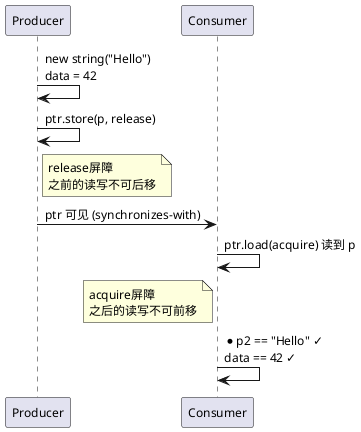
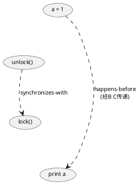

## 1 前言

C++11将多线程纳入标准库，`std::atomic`提供原子操作，但原子性只是底线。考虑一个生产者-消费者场景：线程A往队列写入数据后设置`flag=1`，线程B循环检查`flag`，看到1后读取队列。即使`flag`是原子变量，线程B仍可能看到`flag=1`但读到队列的旧状态——编译器或CPU可能将线程A中"写队列"和"写flag"的顺序打乱，或者线程B将"读flag"和"读队列"的顺序打乱。原子操作保证单个变量的读改写不可分割，但不约束多个变量之间的访问顺序。

`std::atomic`的每个操作接受一个`std::memory_order`参数，控制该操作周围的内存访问顺序。C++定义了六种memory order，组合成三种顺序模型：relaxed（仅原子性）、acquire-release（成对同步）、sequential consistent（全局一致）。默认值`memory_order_seq_cst`提供最强保证，但在弱内存模型架构（ARM、POWER）上代价显著。理解各模型的语义和代价，才能在正确性和性能之间做出合理选择。

## 2 指令重排与内存可见性

CPU和编译器为了性能会重排指令。单线程下这不影响正确性——只要数据依赖不被破坏，重排后的执行结果与顺序执行一致。但多线程下，一个线程观察到的另一个线程的内存操作顺序可能与源码顺序不同。

```c++
// reorder.cc
int x = 0, y = 0;
void thread1() {
    x = 1;     // (1)
    y = 2;     // (2)
}
void thread2() {
    while (y != 2);   // (3)
    assert(x == 1);   // (4)
}
```

(1)和(2)之间没有数据依赖，编译器可能将`y=2`重排到`x=1`之前。线程2跳出循环后`x`可能仍为0，断言失败。这不是编译器的bug——在单线程语义下重排完全合法，问题出在多线程视角下缺少顺序约束。

指令重排有两个来源。编译器在优化时调整指令顺序，例如将不相关的store合并、将load提前到循环外。CPU通过乱序执行、分支预测和store buffer等技术提升吞吐，硬件保证单线程语义不变，但不保证多核间的内存操作顺序与源码一致。x86采用TSO（Total Store Order）模型，只允许store-load重排；ARM和POWER采用弱内存模型，允许几乎所有类型的重排。

## 3 原子操作与修改顺序

`std::atomic`的操作分三类：store（写）、load（读）、read-modify-write（读改写，如`fetch_add`、`exchange`、`compare_exchange`）。每个操作都接受一个memory order参数。

modification order是C++内存模型的基础保证：对同一个原子变量的所有修改操作，存在一个所有线程一致认可的全序。即使使用最宽松的`memory_order_relaxed`，两个线程也不会对同一变量的修改顺序产生分歧。但这只限于单个变量——不同变量之间的修改顺序在各线程看来可能不同。

`memory_order_relaxed`只保证原子性和modification order一致性，不提供任何同步。最反直觉的例子是"无中生有"（Out-of-Thin-Air, OOTA）问题：

```c++
// oota.cc
std::atomic<int> x{0}, y{0};
int r1, r2;
void thread1() {
    r1 = y.load(std::memory_order_relaxed);      // A
    x.store(r1, std::memory_order_relaxed);      // B
}
void thread2() {
    r2 = x.load(std::memory_order_relaxed);      // C
    y.store(42, std::memory_order_relaxed);      // D
}
```

线程2的`y.store(42)`是无条件操作，与前面的`x.load`没有数据依赖，编译器或CPU可将D重排到C之前。重排后D先执行写入42，线程1的A读到42，B将42写入x，线程2的C读到42。最终`r1==42 && r2==42`，看似荒谬——42像是从空气中产生的。但只要42的来源可以追溯到某个无条件store（D），这个结果就是合法的。

合法结果有三种：`(0,0)`、`(42,0)`、`(42,42)`。`(0,42)`不合法——C要读到42，B必须先写入42，而B写入42要求A读到42，A读到42要求D先执行，形成因果链，`(0,42)`无解。

如果给store加上条件：

```c++
// oota_cond.cc
void thread1() {
    r1 = y.load(std::memory_order_relaxed);
    if (r1 == 42)
        x.store(r1, std::memory_order_relaxed);
}
void thread2() {
    r2 = x.load(std::memory_order_relaxed);
    if (r2 == 42)
        y.store(42, std::memory_order_relaxed);
}
```

此时唯一结果是`(0,0)`。两个store都被条件保护，42的写入依赖自身已经发生，形成循环依赖。C++14起标准建议实现不应产生循环依赖自身的OOTA值（should，非强制shall），实际中即使C++11的编译器也不会触发这种情况。

## 4 三种顺序模型

### 4.1 Relaxed

`memory_order_relaxed`可用于store、load和RMW操作，不提供跨线程同步，只保证操作本身的原子性和modification order一致性。

典型场景是引用计数。`std::shared_ptr`增加引用计数用`memory_order_relaxed`——多个线程同时增引用计数互不依赖，只需保证计数本身原子递增。但减少引用计数不能只用relaxed，因为计数归零时要触发析构，减量操作必须与析构建立acquire-release同步，确保析构前所有线程对该对象的访问已完成。

### 4.2 Acquire-Release

`memory_order_acquire`用于load，`memory_order_release`用于store，`memory_order_acq_rel`用于RMW。

release操作保证：该线程在release之前的所有内存读写（包括非原子和relaxed原子操作）不会被重排到release之后。acquire操作保证：该线程在acquire之后的所有内存读写不会被重排到acquire之前。acq_rel同时具备两者的约束，适用于RMW。

如果一个acquire load读到了一个release store写入的值，则该release操作synchronizes-with该acquire操作。这意味着release之前线程的所有内存写入对acquire之后的线程可见。

```c++
// publish.cc
std::atomic<std::string*> ptr{nullptr};
int data{0};
void producer() {
    std::string* p = new std::string("Hello");   // (1)
    data = 42;                                    // (2)
    ptr.store(p, std::memory_order_release);      // (3)
}
void consumer() {
    std::string* p2;
    while (!(p2 = ptr.load(std::memory_order_acquire)))  // (4)
        ;
    assert(*p2 == "Hello");   // (5) 永远成立
    assert(data == 42);       // (6) 永远成立
}
```

(3)是release操作，(1)(2)在(3)之前，不会被重排到(3)之后。(4)是acquire操作，(5)(6)在(4)之后，不会被重排到(4)之前。当(4)读到(3)写入的值时，(3) synchronizes-with (4)。根据happens-before关系链，(1)(2) happens-before (5)(6)，两个assert永远成立。这是C++中最经典的无锁数据传递模式——通过原子变量的release-acquire配对，安全地传递非原子数据。



在强内存模型架构（x86、SPARC TSO）上，acquire-release几乎免费——硬件本身就保证store-load之外不重排，编译器只需避免优化层面的重排，不产生额外CPU指令（"No additional CPU instructions are issued for this synchronization mode; only certain compiler optimizations are affected"[^1]）。在弱内存模型架构（ARM、POWER）上，acquire和release编译为特殊的load/store指令（如ARM的`ldar`/`stlr`）或内存屏障。

### 4.3 Sequentially Consistent

`memory_order_seq_cst`在acquire-release约束之上，额外保证所有seq_cst操作存在一个全局一致的顺序（single total order），所有线程对这个顺序达成一致。这个顺序覆盖所有seq_cst操作（store、load、RMW），意味着不同线程观察到的多个变量的操作顺序也是一致的。

经典的IRIW（Independent Reads of Independent Writes）测试展示了seq_cst与acquire-release的关键差异：

```c++
// iriw.cc
std::atomic<bool> x{false}, y{false};
std::atomic<int> z{0};
void write_x() {
    x.store(true, std::memory_order_seq_cst);     // (1)
}
void write_y() {
    y.store(true, std::memory_order_seq_cst);     // (2)
}
void read_x_then_y() {
    while (!x.load(std::memory_order_seq_cst));   // (3)
    if (y.load(std::memory_order_seq_cst)) ++z;   // (4)
}
void read_y_then_x() {
    while (!y.load(std::memory_order_seq_cst));   // (5)
    if (x.load(std::memory_order_seq_cst)) ++z;   // (6)
}
int main()
{
    std::thread a(write_x);
    std::thread b(write_y);
    std::thread c(read_x_then_y);
    std::thread d(read_y_then_x);
    a.join(); b.join(); c.join(); d.join();
    assert(z.load() != 0); 
}
```

假设`z==0`。则(4)和(6)的load都读到false。线程C跳出循环说明(3)读到true，即(1)在(3)之前；(4)读到false说明(2)在(4)之后。线程D跳出循环说明(5)读到true，即(2)在(5)之前；(6)读到false说明(1)在(6)之后。串联起来：(1) < (3) < (4) < (2) < (5) < (6) < (1)，循环矛盾。seq_cst的全局单一顺序不允许这种悖论，因此`z`不可能为0，assert永远成立。

如果将所有seq_cst换成acquire-release，`z`可能为0。acquire-release只保证成对同步，不保证全局一致——线程C可以认为x先于y变化，线程D可以认为y先于x变化，两边各看到一真一假，双双跳过`++z`。

### 4.4 Consume（deprecated）

`memory_order_consume`是acquire的数据依赖版本。它只约束与该load操作有数据依赖的后续操作，不约束无关操作。实际效果比acquire宽松——无关的load/store仍可重排到consume之前。

问题在于标准中"数据依赖"的形式化定义复杂，主流编译器均未实现完整的依赖链追踪，而是将consume直接提升为acquire。C++17起标准明确建议不要使用consume，C++26起将其deprecated并规定等同于acquire-release。新代码应直接用acquire。

### 4.5 模型对比与选型

四种顺序模型的同步保证、典型场景和本文示例汇总如下。`shared_ptr`的引用计数是一个跨模型的典型案例——增量只需原子性用relaxed，减量要与析构同步用acquire-release，同一场景中不同操作选型不同。

| 模型 | memory_order | 同步保证 | 典型场景 | 本文示例 |
|---|---|---|---|---|
| Relaxed | `relaxed` | 仅原子性 + 修改顺序 | 计数器自增、引用计数增量 | `shared_ptr`增引用计数（4.1） |
| Acquire-Release | `acquire` / `release` / `acq_rel` | release-acquire配对同步 | 生产者-消费者发布、互斥锁、延迟初始化 | 指针发布（4.2）、自旋锁（8.1）、DCLP单例（8.2）、release sequence接力（6）、`shared_ptr`减引用计数（4.1） |
| Sequential Consistent | `seq_cst` | acquire-release + 全局单一顺序 | 多变量交叉观察、不确定时的安全默认 | IRIW测试（4.3、7） |
| (deprecated) | `consume` | 数据依赖同步（实际等同acquire） | C++26 deprecated，用acquire替代 | — |

选型原则：不需要同步用relaxed，需要成对同步用acquire-release，需要多变量全局一致用seq_cst。默认seq_cst是安全选择，但在ARM等弱内存模型架构上，能用acquire-release替代的场景应显式降级。

## 5 happens-before关系链

happens-before是C++内存模型的核心概念，描述操作之间的可见性关系。如果A happens-before B，则A的结果对B可见。happens-before由几个基础关系组合而成。

sequenced-before是同一线程内的顺序关系：源码中前面的语句sequenced-before后面的语句。编译器可以重排指令，但不能破坏sequenced-before关系——重排后的执行结果必须与顺序执行一致。

synchronizes-with是跨线程的同步关系。最常见的来源是release-acquire配对：线程A的release store与线程B读到该值的acquire load构成synchronizes-with。mutex的unlock-lock也构成synchronizes-with。

inter-thread happens-before组合了上述关系：如果A synchronizes-with B，则A inter-thread happens-before B；如果A inter-thread happens-before X且X sequenced-before B，则A inter-thread happens-before B。这个链条可以跨线程传递可见性。

```c++
// happens_before.cc
int a = 0;
std::mutex mu;
void thread1() {
    a = 1;           // (1)
    mu.unlock();     // (2)
}
void thread2() {
    mu.lock();       // (3)
    std::cout << a;  // (4)
}
```

推演过程：(1) sequenced-before (2)；(2) synchronizes-with (3)；(3) sequenced-before (4)。因为(2) synchronizes-with (3)且(3) sequenced-before (4)，所以(2) inter-thread happens-before (4)。因为(1) sequenced-before (2)且(2) inter-thread happens-before (4)，所以(1) inter-thread happens-before (4)，即(1) happens-before (4)。(4)保证读到`a==1`。



## 6 Release Sequence

release-acquire同步要求acquire load读到release store写入的值。如果中间有其他线程修改了该变量，同步能否传递取决于release sequence。

release操作A在原子变量M上执行后，M上后续的一个操作序列构成以A为首的release sequence：C++20前包括A所在线程的后续写操作和任意线程的RMW操作；C++20起仅包括RMW操作。如果acquire load读到了release sequence中任意一个操作写入的值，则A synchronizes-with该acquire load。

```c++
// release_sequence.cc
std::vector<int> data;
std::atomic<int> flag{0};
void thread1() {
    data.push_back(42);                           // (1)
    flag.store(1, std::memory_order_release);     // (2)
}
void thread2() {
    int expected = 1;
    while (!flag.compare_exchange_strong(
        expected, 2, std::memory_order_relaxed))  // (3)
        expected = 1;
}
void thread3() {
    while (flag.load(std::memory_order_acquire) < 2);  // (4)
    assert(data.at(0) == 42);                          // (5) 永远成立
}
```

(3)是RMW操作，用`memory_order_relaxed`。它本身不与(2)建立synchronizes-with——relaxed不提供同步语义。但(3)属于(2)的release sequence，因为RMW操作无论用什么memory order都属于release sequence。当(4)以acquire读到(3)写入的值2时，(2) synchronizes-with (4)。(1) sequenced-before (2)，(4) sequenced-before (5)，因此(1) happens-before (5)，assert永远成立。

如果thread2不用RMW而是先`load`再`store`：

```c++
// release_sequence_broken.cc
void thread2_bad() {
    while (flag.load(std::memory_order_relaxed) != 1);
    flag.store(2, std::memory_order_relaxed);  // 不是RMW，不属于release sequence
}
```

普通store不是RMW，不接入release sequence。thread3读到2时，(2)与(4)之间没有synchronizes-with关系，(5)的assert可能失败。RMW操作之所以特殊，是因为它原子地"读取旧值并写入新值"，在modification order中与前一个操作连续，C++标准据此将其纳入release sequence。

## 7 IRIW与内存模型强度对比

IRIW测试揭示了seq_cst与acquire-release的本质差异。在seq_cst模型下，所有seq_cst操作存在全局单一顺序，线程C和D对x、y的修改顺序达成一致，不可能同时看到"一真一假"，`z`不可能为0。在acquire-release模型下，不同线程对独立变量的修改顺序可以有不同视角，`z`可能为0。

这种差异的根源在硬件层面。x86采用TSO模型，store进入store buffer后按先进先出顺序刷入缓存，所有核心看到的store顺序一致。acquire-release在x86上几乎免费——store本身就是release语义（store之前的load/store不会被重排到store之后），load本身就是acquire语义（load之后的load/store不会被重排到load之前），对大部分操作无需额外CPU指令（"release-acquire ordering is automatic for the majority of operations"[^1]）。seq_cst的store在x86上需要额外的`MFENCE`或`LOCK`前缀指令，防止store-load重排，保证全局顺序。

ARM和POWER采用弱内存模型，硬件允许store-store、load-load、load-store、store-load全部重排。acquire load编译为`ldar`（load-acquire），release store编译为`stlr`（store-release），这些指令自带单向屏障。seq_cst操作需要`dmb ish`（full memory barrier）或更强指令，开销显著高于acquire-release。

实际工程中，如果acquire-release已足够保证正确性，不应默认使用seq_cst。判断标准是程序是否依赖多个变量之间的全局顺序一致性。单生产者-单消费者的release-acquire配对不需要seq_cst；涉及多变量交叉观察的场景（如IRIW）才需要。


## 8 实践

### 8.1 自旋锁

自旋锁用RMW操作抢占锁，unlock用release保证临界区的写操作对下一个lock可见：

```c++
// spinlock.h
class Spinlock {
    std::atomic<bool> flag_{false};
public:
    void lock() {
        while (flag_.exchange(true, std::memory_order_acquire))  // (1)
            ;
    }
    void unlock() {
        flag_.store(false, std::memory_order_release);  // (2)
    }
};
```

`exchange`是RMW操作，用`memory_order_acquire`时只保证其读部分是acquire。当(1)的exchange返回false（读到旧值false并写入true）时，与上一次(2)的release store构成synchronizes-with，临界区内前一次锁持有者的写操作对当前线程可见。

### 8.2 双重检查锁定单例

单例模式的双重检查锁定（DCLP）是memory order的经典应用场景：

```c++
// singleton.h
class App {
    static std::atomic<App*> instance_;
    static std::mutex mu_;
public:
    static App* get_instance() {
        App* p = instance_.load(std::memory_order_acquire);   // (1)
        if (!p) {
            std::lock_guard<std::mutex> guard(mu_);
            p = instance_.load(std::memory_order_relaxed);    // (2)
            if (!p) {
                p = new App;                                   // (3)
                instance_.store(p, std::memory_order_release); // (4)
            }
        }
        return p;
    }
};
```

(4)用release保证(3)的对象构造对(1)的acquire load可见。如果(1)读到(4)写入的指针，(4) synchronizes-with (1)，(3) happens-before (1)，解引用`p`安全。

(2)用relaxed是因为它在锁保护下，mutex的lock-unlock已提供synchronizes-with，不需要额外的内存序约束。如果(1)也用relaxed，线程2读到(4)写入的指针时，(3)的构造可能还没对线程2可见，解引用得到不完整的对象。

## references

1. std::memory_order — https://en.cppreference.com/w/cpp/atomic/memory_order
2. C++ Concurrency in Action (2nd Edition), Anthony Williams
3. 谈谈 C++ 中的内存顺序 (Memory Order) — https://luyuhuang.tech/2022/06/25/cpp-memory-order.html
4. c++中的memory order问题 — https://redhand.com.cn/2024/03/17/memory-order/

[^1]: cppreference "Release-Acquire ordering" 节，描述强内存模型架构上acquire-release的编译器/硬件开销。[1]