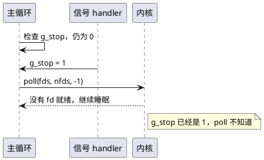

## 1 前言

事件循环的阻塞点通常是一个`poll`、`select`或`epoll_wait`。网络fd可读可写时这些调用返回，进程还要处理另一类事件：信号、其他线程投递的任务、定时器。把信号直接接进事件循环，常见写法是在handler里置一个`volatile sig_atomic_t`标志（`sig_atomic_t`保证写入在信号处理过程中不可分割，`volatile`禁止编译器把它缓存进寄存器），主循环检查标志后再进入`poll`。这个写法有两个独立的问题。

handler的运行环境不受控：它可能打断`malloc`持锁的瞬间，handler里再调用`printf`或`malloc`会去拿同一把锁，进程死锁。另一个问题是检查与等待之间的窗口：标志在检查之后、`poll`之前被置位，`poll`仍会睡下去。`EINTR`只能处理“信号在等待期间到达”的情况，补不上这个窗口。

self-pipe把两个问题一起消掉：handler只向管道写一个dummy字节，主循环把管道读端加入`poll`集合。这样异步信号就转换成了可读fd，统一交给主循环的`poll`同步处理。这套机制同时适用于信号和跨线程唤醒，PostgreSQL的latch和不少网络库的事件循环都在用。

## 2 async-signal-safe

信号handler可以随时打断主流程。考虑`main`正在`malloc`内部持有堆锁，信号到达，handler为了记录日志调用`printf`，`printf`内部也要拿锁，锁已经被主流程持有，handler永远等不到，进程死锁。`free`、`fopen`、`syslog`有同样的问题。POSIX把这些函数排除在async-signal-safe列表之外，只保证`write`、`read`、`close`、`_exit`、`sigaction`、`kill`等少数函数可以在handler中调用。

```c++
// bad_handler.cpp
static volatile sig_atomic_t g_stop = 0;

void on_signal(int signo) {
    printf("signal %d\n", signo);  // printf 不是 async-signal-safe
    g_stop = 1;
}
```

`errno`是另一个容易漏掉的点。handler可能改写`errno`，返回主流程后原来的错误码已经丢失，后续的`perror`或错误分支会读到错误值。下面的`handle_signal`出自第5节的`SignalPipe`——所有信号共用这一个handler，先在无锁原子数组里记下到达的信号（不加锁才不会在handler里死锁），再向管道写端写一个dummy字节，管道创建和安装接口在第5节交代。开头保存、结尾恢复`errno`：

```c++
// signal_pipe.cpp
void SignalPipe::handle_signal(int signo, siginfo_t*, void*) {
    int saved_errno = errno;
    if (signo > 0 && signo < kMaxSignal) {
        // pending_ 为无锁 std::atomic<uint8_t> 数组（编译期 static_assert is_always_lock_free）
        pending_[signo].store(1, std::memory_order_release);
    }
    // 唤醒型：写一个 dummy 字节，不传信号编号
    char byte = 1;
    ssize_t written;
    do {
        written = ::write(write_fd_, &byte, 1);
    } while (written == -1 && errno == EINTR);
    // EAGAIN：管道里已有字节，足够唤醒，安全忽略
    (void)written;
    errno = saved_errno;
}
```

`sigaction`的`SA_RESTART`标志让被信号打断的系统调用自动重启，但Linux上`poll`、`select`、`epoll_wait`不在重启之列：无论是否设置`SA_RESTART`，被信号打断且无fd就绪时都返回`EINTR`。依赖`SA_RESTART`处理唤醒，会受限于不同操作系统的实现差异，不可移植。代码里仍然要对`EINTR`做重试，同时不能把重试当成完整的解决方案。

## 3 竞态

只置标志的写法有一个更隐蔽的问题：检查标志和进入等待不是原子的。

```c++
// flag_only.cpp
static volatile sig_atomic_t g_stop = 0;

void on_term(int) {
    g_stop = 1;
}

while (!g_stop) {
    poll(fds, nfds, -1);  // 信号可能在上一次检查之后、进入这里之前到达
}
```



时间线里信号在检查之后、`poll`之前到达。handler已经置位，`poll`却只关心fd，没有理由返回。若信号在`poll`睡眠期间到达，`poll`会被打断并返回`EINTR`，主循环重试后能看到标志；丢失只发生在进入等待之前的那个窗口。

`pselect`、`ppoll`、`epoll_pwait`在进入等待的调用里原子替换信号掩码——先阻塞、等待时解除——信号只能落在“已经准备好等待”之后。self-pipe走另一条路，不改变信号掩码，而是让通知在管道里排队，`poll`无论如何都能看到它。

## 4 self-pipe的工作方式

`pipe()`创建一对fd，读端加入事件循环的监听集合，写端只在handler或唤醒者里使用。管道的缓冲区把写入保存下来，即使信号在`poll`之前到达，读端也已经可读，`poll`会立即返回。

self-pipe有两种用法，**它们互斥，不应共用同一条管道**：

- **唤醒型**：只写一个dummy字节，真实状态放在`volatile sig_atomic_t`标志或同步队列里，管道只负责把线程从`poll`里叫醒。适合latch、跨线程消息队列这类“状态在别处”的场景。
- **数据型**：把信号编号（一个`int`）写进管道，主循环读出后按编号调用回调。适合信号到回调的一一映射。

唤醒型是推荐方案：管道只负责唤醒，丢弃字节不影响正确性，实现也最简单。数据型看似更直观，但管道是字节流，没有消息边界，读取方必须自己缓存并拼接残余字节、还原完整消息；而且管道满时`write`返回`EAGAIN`，具体信号编号被丢弃——SIGINT到达时管道已满、写入失败，稍后到达的SIGUSR1却正常入管，进程就在不知情中错过了一次终止请求。

两种用法都依赖同一个前提：写端必须是非阻塞的。唤醒型管道满时`write`返回`EAGAIN`，可以安全忽略，因为“有唤醒待处理”这个信息已经足够；数据型不能忽略`EAGAIN`，此时丢掉的是具体信号编号。self-pipe的定位是唤醒而不是可靠队列，需要严格计数的场景应使用普通计数器或消息队列。写端如果是阻塞的，handler会卡在`write`里，整个进程停住。

下面的C++实现以唤醒型为主线：signal handler在无锁原子表里标记到达的信号并写dummy字节唤醒，主循环再按标记分发业务回调；第6节的跨线程唤醒同样写dummy字节，使用各自独立的管道。

## 5 C++实现

`SignalPipe`把所有状态收进一个对象：pipe fd、待处理信号标志表（无锁`std::atomic<uint8_t>`）、业务回调表、旧`sigaction`与安装标记。`init`只做一次，创建管道并设置`O_CLOEXEC | O_NONBLOCK`；`set_handler`安装统一的`sigaction`；`dispatch`在主循环上下文里排空管道并按待处理标志分发。

```c++
// signal_pipe.cpp
bool SignalPipe::init(std::string* error) {
    if (read_fd_ != -1 || instance_ != nullptr) {
        if (error) *error = "already initialized";
        return false;
    }

    int fds[2];
    if (::pipe2(fds, O_CLOEXEC | O_NONBLOCK) == -1) {
        if (error) *error = errno_message("pipe2");
        return false;
    }

    read_fd_ = fds[0];
    write_fd_ = fds[1];
    instance_ = this;
    return true;
}
```

`pipe2`是Linux接口，其他UNIX用`pipe`加两次`fcntl`完成同样的事。两个fd都设`O_NONBLOCK`，读端为了`dispatch`能读到`EAGAIN`为止，写端为了handler不阻塞。`O_CLOEXEC`防止fd泄漏给`exec`的子进程。

```c++
// signal_pipe.cpp
bool SignalPipe::set_handler(int signo, Handler handler) {
    if (signo <= 0 || signo >= kMaxSignal) return false;

    handlers_[signo] = std::move(handler);
    if (installed_[signo]) return true;  // 已安装过 sigaction，仅替换业务回调

    struct sigaction sa;
    std::memset(&sa, 0, sizeof(sa));
    sigemptyset(&sa.sa_mask);
    sa.sa_sigaction = &SignalPipe::handle_signal;
    sa.sa_flags = SA_SIGINFO | SA_RESTART;

    // 仅首次安装时保存旧 sigaction，析构时恢复
    struct sigaction old_sa;
    if (::sigaction(signo, &sa, &old_sa) == -1) {
        handlers_[signo] = nullptr;
        return false;
    }
    old_handlers_[signo] = old_sa;
    installed_[signo] = true;
    return true;
}
```

`dispatch`先排空管道里的字节，再逐项检查并原子清零`pending_[signo]`，只对实际到达的信号调用业务回调。先排空、后回调把读取和业务处理分开；回调期间到达的新信号会重新置位并写入管道，下一轮`poll`会再次唤醒。

```c++
// signal_pipe.cpp
int SignalPipe::dispatch() {
    char buf[256];
    for (;;) {
        ssize_t n = ::read(read_fd_, buf, sizeof(buf));
        if (n > 0) continue;          // 排空管道里的字节
        if (n == -1 && errno == EINTR) continue;
        if (n == -1 && (errno == EAGAIN || errno == EWOULDBLOCK)) break;  // 管道已空
        if (n == 0) return -1;        // EOF：写端意外关闭（不应发生）
        return -1;                    // 其他错误：向上返回失败，不能伪装成正常排空
    }

    int dispatched = 0;
    for (int signo = 1; signo < kMaxSignal; ++signo) {
        if (pending_[signo].exchange(0, std::memory_order_acq_rel) && handlers_[signo]) {
            handlers_[signo](signo);
            ++dispatched;
        }
    }
    return dispatched;
}
```

管道写入不大于`PIPE_BUF`时是原子的，一个字节不会与其他写入交错。但管道是字节流，没有消息边界；唤醒型只写dummy字节，读取方不需要解析内容，只需排空。数据型如果要用定长记录，读取方必须保存并重组残余字节，不能假设每次`read`都返回整数条记录。

主循环侧把读端当成一个普通fd加进`poll`集合即可：

```c++
// main.cpp（骨架，省略资源管理和完整错误处理）
bool running = true;

SignalPipe signals;
if (!signals.init(&error)) {
    // 处理 pipe2 失败
}

// 业务回调在主循环 dispatch() 上下文中执行，不需要 async-signal-safe
auto on_stop = [&](int) {
    running = false;
};
if (!signals.set_handler(SIGINT, on_stop)) { /* 处理失败 */ }
if (!signals.set_handler(SIGTERM, on_stop)) { /* 处理失败 */ }

struct pollfd fds[2] = {
    {listen_fd, POLLIN, 0},       // 任一业务fd
    {signals.read_fd(), POLLIN, 0},
};
while (running) {
    int n = ::poll(fds, 2, -1);
    if (n == -1) {
        if (errno == EINTR) continue;  // 字节已在管道里，重试不丢唤醒
        break;                          // 其他错误：退出
    }
    if (fds[1].revents & POLLIN) {
        if (signals.dispatch() == -1) break;  // 管道读取异常
    }
}
```

信号到达时，`handle_signal`先置位`pending_[signo]`再写唤醒字节，`poll`以`POLLIN`返回，`dispatch`排空管道并按待处理标志在主循环上下文调用`on_stop`。终止判断不依赖管道里的数据内容——即使管道已满、写入返回`EAGAIN`，管道里原本就有未读字节，且`pending_[signo]`已经置位，下一轮`dispatch`仍会触发退出回调。`EINTR`分支直接重试即可，唤醒字节已经在管道里等着。

| 细节 | 原因 | 处理 |
|---|---|---|
| 写端非阻塞 | handler不能阻塞 | `pipe2(... O_NONBLOCK)`，`EAGAIN`视为已有唤醒 |
| `write`重试`EINTR` | handler可能被其他信号打断 | `do/while`重试，保存并恢复`errno` |
| 先drain后dispatch | 分离读取和业务处理 | 先排空管道，回调期间到达的通知留待下一轮 |
| 读端非阻塞 | 收尾的`read`不能挂住 | `O_NONBLOCK`，`EAGAIN`结束循环 |
| `CLOEXEC` | 防止fd泄漏给子进程 | `pipe2`的`O_CLOEXEC` |
| `SIGPIPE` | 读端关闭后写入触发`SIGPIPE` | 保持读端打开，或忽略`SIGPIPE` |
| fork | 子进程继承fd | 子进程关闭不需要的副本 |
| 多线程 | 进程信号可能投递到任意线程 | 需要固定线程时用`pthread_sigmask`屏蔽其他线程 |

多线程下，进程级信号可由任一未屏蔽它的线程执行handler。但handler写的是同一个进程级管道，事件循环线程仍会在自己的`poll`上被唤醒——唤醒不会落在没有监听管道的线程上。屏蔽其他线程的目的是让handler在固定线程执行、减少信号嵌套，或使用`signalfd`时满足其阻塞要求，而不是self-pipe唤醒事件循环的必要条件。`signalfd`把阻塞做成硬性要求——信号不阻塞就按原本的处理方式执行（比如默认终止进程，或运行已安装的handler），fd上永远读不到——self-pipe没有这个限制。

`SIGPIPE`只在读端已经关闭时出现。正常生命周期里读端一直打开。析构时先恢复旧handler，再关闭写端和读端，就不会触发。注意，恢复handler不会等待其他线程中已经进入执行、尚未返回的旧handler结束；关闭fd前应停止写入者并确保没有仍在执行的旧handler，否则这些handler或生产者可能写入已关闭、甚至已复用的fd。若这些过程省略，示例仅适用于受控的单线程生命周期。若业务代码可能提前关闭读端，启动时用`signal(SIGPIPE, SIG_IGN)`或类的`set_ignore(SIGPIPE)`兜底。

## 6 跨线程唤醒

事件循环不只等信号，还要被其他线程叫醒。主线程平时阻塞在`poll`里等待网络fd和信号，没法同时等`std::condition_variable`，因此需要一条**独立于信号管道的**唤醒管道：任务数据仍走内存队列，管道只写一个无意义的字节负责把`poll`叫醒。线程B把任务放进队列后按需写管道；线程A从`poll`返回，先排空管道，再在同一把锁里交换队列并清掉通知标志。下面省略了`WakeupQueue`的类定义和`init()`，代码里的`read_fd_`和`write_fd_`是它独立用`pipe2`创建的非阻塞管道（不与`SignalPipe`共用），`read_fd_`挂在线程A的`poll`集合里。

```c++
// wakeup_queue.hpp
// 线程B（生产者）调用
bool post(int value) {
    bool need_write = false;
    {
        std::lock_guard<std::mutex> lock(mutex_);
        queue_.push_back(value);
        // 已有待处理通知时不再重复写管道，合并唤醒
        if (!notified_) {
            notified_ = true;
            need_write = true;
        }
    }
    // 在锁外执行 write，避免持锁做系统调用
    if (need_write) {
        char byte = 1;
        ssize_t written;
        do {
            written = ::write(write_fd_, &byte, 1);
        } while (written == -1 && errno == EINTR);
        if (written == -1 && errno != EAGAIN && errno != EWOULDBLOCK) {
            // EAGAIN 表示管道已满（里面已有未读字节）；EBADF/EPIPE 等错误不能忽略，
            // 需复位 notified_ 并向上报错，避免后续生产者永久停止唤醒
            std::lock_guard<std::mutex> lock(mutex_);
            notified_ = false;
            return false;
        }
    }
    return true;
}

// 线程A（事件循环）在 poll 返回后调用
std::vector<int> take() {
    // 先在锁外排空管道，再进锁换队列并清 notified_
    char buf[256];
    for (;;) {
        ssize_t n = ::read(read_fd_, buf, sizeof(buf));
        if (n > 0) continue;
        if (n == -1 && errno == EINTR) continue;
        if (n == -1 && (errno == EAGAIN || errno == EWOULDBLOCK)) break;  // 管道已空
        if (n == 0) break;            // EOF（不应发生）
        break;                        // 其他读错误，放弃继续排空
    }

    // 交换队列和清标志必须在同一把锁内完成
    std::lock_guard<std::mutex> lock(mutex_);
    std::vector<int> batch;
    batch.swap(queue_);
    notified_ = false;
    return batch;
}
```

`notified_`用来合并唤醒：第一个入队的生产者看到`notified_`为假，将其置为真并在锁外写1字节；在消费者`take`清零之前，后续生产者看到标志为真（说明管道里已有字节，或前一个生产者正准备写入）就只入队不写管道，省掉多余的`write`调用。如果`write`遇到`EBADF`、`EPIPE`这类真错误，必须回锁复位`notified_`，否则后续生产者会一直以为已经通知过而不再写管道。

`take`的顺序有两个硬约束：

- **先排空管道，再换队列并清`notified_`**：若反过来先清标志再`read`，间隙里新生产者入队并写下的字节可能被这次`read`顺手吞掉，导致队列非空、管道却空了，且`notified_`仍为真，后续消息也不再写管道。
- **换队列和清`notified_`必须在同一把锁内**：若先`swap`放锁再去清标志，间隙里入队的生产者看到`notified_`仍为真就会跳过写管道，随后标志被清零，同样丢失唤醒。

按现在的顺序，排空管道期间哪怕有新消息入队，紧接着的`swap`也会把它一并带走；若生产者在锁外延迟了`write`，导致消费者`swap`之后字节才落进管道，下一轮`poll`顶多多醒一次并取到空`batch`，属于无害的空唤醒，不会丢消息。

多次通知合并成一个字节后，实际唤醒次数可显著少于消息数，具体比例取决于调度。skywind的poll封装用`pipe_written`标志做同样的合并，并在每次醒来后调用`poller_pipe_reset`。

Windows的`select`只接受socket，不接受管道，跨平台库通常用`socketpair`或两个已连接的socket代替。Linux的`eventfd`更直接：内核维护一个64位计数器，`write`累加，`read`取走并清零，`EFD_SEMAPHORE`让每次`read`只减一。它没有两个fd，也不会产生`SIGPIPE`，适合纯计数唤醒；局限是只有Linux支持，而且不能像self-pipe那样顺带承载信号编号。

## 7 替代方案对比

`pselect`、`ppoll`、`epoll_pwait`在等待调用里多一个`sigmask`参数，进入睡眠时原子地替换调用线程的信号掩码，返回时恢复。调用方在检查标志前先阻塞信号，检查完再交给等待函数解除阻塞，信号只能落在已经开始等待之后。`pselect`的`timeout`是`timespec`，用纳秒表示超时（不保证实际唤醒能达到纳秒精度）；`ppoll`已纳入POSIX.1-2024（早期为Linux扩展），`epoll_pwait`是Linux扩展。

表中“信号需阻塞”指该机制要求相关信号处于blocked状态才有意义：`pselect`一族靠阻塞保证信号只能落在等待期间、由handler先行处理，`signalfd`靠阻塞让信号以可读数据进fd。self-pipe不要求阻塞，因为handler仍然通过`sigaction`安装。

| 机制 | 平台 | 携带数据 | 信号需阻塞 | 备注 |
|---|---|---|---|---|
| self-pipe | POSIX | 信号编号或自定义数据 | 否 | 可用于任意I/O多路复用器 |
| `pselect` | POSIX | 否，靠标志 | 是 | `timespec`超时 |
| `ppoll` | POSIX.1-2024 | 否，靠标志 | 是 | `poll`加`sigmask`（早期为Linux扩展） |
| `epoll_pwait` | Linux | 否，靠标志 | 是 | `epoll`加`sigmask` |
| `signalfd` | Linux 2.6.22+ | `signalfd_siginfo` | 是 | 标准信号仍会合并 |
| `eventfd` | Linux 2.6.22+ | 64位计数器 | 否 | 只做唤醒，不承载信号 |
| `timerfd` | Linux 2.6.25+ | 到期次数 | 否 | 定时器转fd |

`signalfd`把信号变成可读fd，读取的是`signalfd_siginfo`，带`si_pid`、`si_code`等字段，比self-pipe的dummy字节信息更全。代价是必须阻塞信号，否则信号按原本的处理方式执行（比如默认终止进程，或运行已安装的handler）；多线程程序要在所有线程里屏蔽，才能保证由目标线程读取。标准信号在`signalfd`里同样会合并，不会变成可靠队列。

`eventfd`和`timerfd`解决的是另外两类事件，不替代信号处理。`eventfd`适合跨线程唤醒和计数，`timerfd`适合把定时器接入`poll`。self-pipe的价值在于它同时满足“POSIX可移植、可接任意多路复用器、不需要阻塞信号、可承载少量数据”——不过POSIX `socketpair`也能满足这些条件，self-pipe的优势更多在于简单和直观。

`pselect`在Linux 2.6.16之前由glibc用`sigprocmask`加`select`模拟，模拟版本仍然存在它本应消除的竞态；现代glibc在有系统调用时使用无竞态的实现。老内核上的可移植性因此要多看一眼。

## 8 PostgreSQL latch

PostgreSQL的`latch.c`把self-pipe用在进程内的等待唤醒上。文件头注释直接点出动机：信号本身在部分平台上不会打断`poll`，即使在会打断的平台上，信号在`poll`调用之前到达也不会阻止它进入睡眠；管道里的字节则能可靠地让`poll`立即返回。注释里的原话是“a signal that arrives just before the poll() call does not prevent poll() from entering sleep”，管道字节解决的就是这个窗口。

```c
// latch.c
if (pipe(pipefd) < 0)
    elog(FATAL, "pipe() failed: %m");
if (fcntl(pipefd[0], F_SETFL, O_NONBLOCK) == -1)
    elog(FATAL, "fcntl(F_SETFL) failed on read-end of self-pipe: %m");
if (fcntl(pipefd[1], F_SETFL, O_NONBLOCK) == -1)
    elog(FATAL, "fcntl(F_SETFL) failed on write-end of self-pipe: %m");
if (fcntl(pipefd[0], F_SETFD, FD_CLOEXEC) == -1)
    elog(FATAL, "fcntl(F_SETFD) failed on read-end of self-pipe: %m");
if (fcntl(pipefd[1], F_SETFD, FD_CLOEXEC) == -1)
    elog(FATAL, "fcntl(F_SETFD) failed on write-end of self-pipe: %m");
```

写端和读端都设非阻塞，两个fd都设`FD_CLOEXEC`。唤醒信号选的是`SIGURG`，handler只在进程处于等待状态时写一个字节；等待与否由`waiting`标志记录，进入`WaitLatch`时置位、返回前清零。

```c
// latch.c
static void latch_sigurg_handler(SIGNAL_ARGS) {
    if (waiting)
        sendSelfPipeByte();
}

static void sendSelfPipeByte(void) {
    int rc;
    char dummy = 0;
retry:
    rc = write(selfpipe_writefd, &dummy, 1);
    if (rc < 0) {
        if (errno == EINTR)
            goto retry;
        if (errno == EAGAIN || errno == EWOULDBLOCK)
            return;  // 管道里已有字节，足够唤醒
        return;
    }
}
```

这里写的是dummy字节，不是信号编号。latch的真实状态在`is_set`标志和等待状态机里，管道只负责把`poll`叫醒——第4节的唤醒型正是这个分工；醒来后代码检查latch状态，而不是从管道里解析事件。这个选择让多次`SetLatch`自然合并成一次唤醒，`EAGAIN`也可以安全忽略。

```c
// latch.c
static void drain(void) {
    char buf[1024];
    int fd = selfpipe_readfd;

    for (;;) {
        int rc = read(fd, buf, sizeof(buf));
        if (rc < 0) {
            if (errno == EAGAIN || errno == EWOULDBLOCK)
                break;          // 管道已空
            else if (errno == EINTR)
                continue;       // 被信号打断
            else
                elog(ERROR, "read() on self-pipe failed: %m");
        } else if (rc == 0) {
            elog(ERROR, "unexpected EOF on self-pipe");
        } else if (rc < sizeof(buf)) {
            break;              // 短读：原注释据此视为已排空
        }
    }
}
```

`drain`在错误和EOF分支都会把`waiting`清零，这段省略了该状态处理。短读分支沿用原注释的判断——"we successfully drained the pipe; no need to read() again"；即使读之后又有新信号写入，残留数据让fd保持可读，下一轮`poll`照样立即返回。

`latch.c`在编译时会根据操作系统选择底层的事件等待机制：通用POSIX的`poll`路径用self-pipe；Linux的`epoll`路径把`SIGURG`阻塞后用`signalfd`，fd直接进`epoll`；BSD/macOS的`kqueue`路径用`EVFILT_SIGNAL`监听`SIGURG`；Windows用可继承的Event对象。四种实现的目标一致：把“有人设置了latch”变成等待接口能识别的就绪事件，避免检查与睡眠之间的竞态窗口。self-pipe是其中可移植性最好、依赖最少的一种。

`SetLatch`在检查`is_set`前和置位后各放一次内存屏障，等待侧则先置`maybe_sleeping`、再放内存屏障并重新检查`is_set`——这些内存屏障用于防止CPU和编译器乱序重排，避免“唤醒方刚置位、等待方却没看到而睡死”。管道字节和这两个标志配合，覆盖“信号在检查前到达”“信号在检查后、睡眠前到达”“信号在睡眠中到达”三种情况。细节在`WaitEventSetWait`和`SetLatch`里，self-pipe只是其中的唤醒通道。

## references

1. [C语言] 安全的信号处理：Self-Pipe技巧 — https://nimfsoft.art/zh/blog/2025/07/23/c-safe-signal-handling-self-pipe/
2. PostgreSQL随手记（6）latch实现中self-pipe trick解决什么问题 — https://cloud.tencent.com/developer/article/2048174
3. 异步事件模型的Self-pipe trick — https://skywind.me/blog/archives/3163
4. Self-Pipe Trick, pselect() and ppoll() Explained — https://embeddedpathashala.com/self-pipe-trick-pselect-and-ppoll-explained/
5. POSIX signal safety — https://man7.org/linux/man-pages/man7/signal-safety.7.html
6. pselect(2) — https://man7.org/linux/man-pages/man2/pselect.2.html
7. signalfd(2) — https://man7.org/linux/man-pages/man2/signalfd.2.html
8. eventfd(2) — https://man7.org/linux/man-pages/man2/eventfd.2.html
9. timerfd_create(2) — https://man7.org/linux/man-pages/man2/timerfd_create.2.html
10. PostgreSQL latch.c — https://github.com/postgres/postgres/blob/REL_17_STABLE/src/backend/storage/ipc/latch.c
11. The self-pipe trick — https://cr.yp.to/docs/selfpipe.html