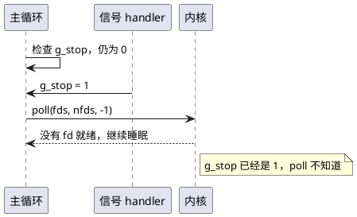
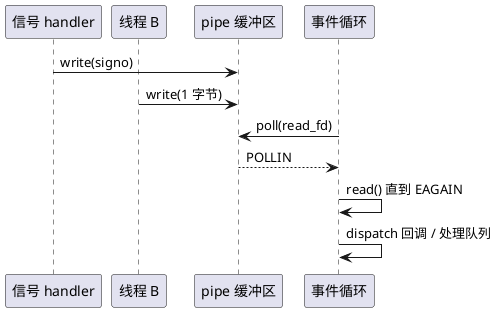

## 1 前言

事件循环的阻塞点通常是一个`poll`、`select`或`epoll_wait`。网络fd可读可写时这些调用返回，进程还要处理另一类事件：信号、其他线程投递的任务、定时器。把信号直接接进事件循环，常见写法是在handler里置一个`volatile sig_atomic_t`标志（`sig_atomic_t`保证写入在信号处理过程中不可分割，`volatile`禁止编译器把它缓存进寄存器），主循环检查标志后再进入`poll`。这个写法有两个独立的问题。

handler的运行环境不受控：它可能打断`malloc`持锁的瞬间，handler里再调用`printf`或`malloc`会去拿同一把锁，进程死锁。另一个问题是检查与等待之间的窗口：标志在检查之后、`poll`之前被置位，`poll`仍会睡下去。`EINTR`只能处理“信号在等待期间到达”的情况，补不上这个窗口。

self-pipe把两个问题一起消掉：handler只向管道写一个整数，主循环把管道读端加入`poll`集合。信号被转换成fd可读，异步通知进入同步的I/O事件流。这套机制同时适用于信号和跨线程唤醒，PostgreSQL的latch和不少网络库的事件循环都在用。

## 2 async-signal-safe

信号handler可以随时打断主流程。考虑`main`正在`malloc`内部持有堆锁，信号到达，handler为了记录日志调用`printf`，`printf`内部也要拿锁，锁已经被主流程持有，handler永远等不到，进程死锁。`free`、`fopen`、`syslog`有同样的问题。POSIX把这些函数排除在async-signal-safe列表之外，只保证`write`、`read`、`close`、`_exit`、`sigaction`、`kill`等少数函数可以在handler中调用。

```c++
// bad_handler.cpp
static volatile sig_atomic_t g_stop = 0;

void on_signal(int signo) {
    printf("signal %d\n", signo);  // printf 不是 async-signal-safe
    g_stop = 1;
}
```

`errno`是另一个容易漏掉的点。handler可能改写`errno`，返回主流程后原来的错误码已经丢失，后续的`perror`或错误分支会读到错误值。下面的`handle_signal`出自第5节的`SignalPipe`——所有信号共用这一个handler，把信号编号写进同一个管道写端，管道创建和安装接口在第5节交代。开头保存、结尾恢复`errno`：

```c++
// signal_pipe.cpp
void SignalPipe::handle_signal(int signo, siginfo_t*, void*) {
    int saved_errno = errno;
    int value = signo;
    ssize_t written;
    do {
        written = ::write(write_fd_, &value, sizeof(value));
    } while (written == -1 && errno == EINTR);
    (void)written;
    errno = saved_errno;
}
```

`sigaction`的`SA_RESTART`标志让被信号打断的系统调用自动重启，但Linux上`poll`、`select`、`epoll_wait`不在重启之列：无论是否设置`SA_RESTART`，信号到达都返回`EINTR`。依赖`SA_RESTART`处理唤醒，等于把行为交给平台细节。代码里仍然要对`EINTR`做重试，同时不能把重试当成完整的解决方案。

## 3 竞态

只置标志的写法有一个更隐蔽的问题：检查标志和进入等待不是原子的。

```c++
// flag_only.cpp
static volatile sig_atomic_t g_stop = 0;

void on_term(int) {
    g_stop = 1;
}

while (!g_stop) {
    poll(fds, nfds, -1);  // 信号可能在上一次检查之后、进入这里之前到达
}
```



时间线里信号在检查之后、`poll`之前到达。handler已经置位，`poll`却只关心fd，没有理由返回。若信号在`poll`睡眠期间到达，`poll`会被打断并返回`EINTR`，主循环重试后能看到标志；丢失只发生在进入等待之前的那个窗口。

`pselect`、`ppoll`、`epoll_pwait`在进入等待的调用里原子替换信号掩码——先阻塞、等待时解除——信号只能落在“已经准备好等待”之后。self-pipe走另一条路，不改变信号掩码，而是让通知在管道里排队，`poll`无论如何都能看到它。

## 4 self-pipe的工作方式

`pipe()`创建一对fd，读端加入事件循环的监听集合，写端只在handler里使用。handler写入一个`int`，内容是信号编号。管道的缓冲区把这次写入保存下来，即使信号在`poll`之前到达，读端也已经可读，`poll`会立即返回。



图上两条写入路径对应两种用法。数据型把信号编号写进管道，主循环读出后按编号调用回调；唤醒型只写一个dummy字节，真实状态放在flag或队列里，管道只负责把线程从`poll`里叫醒。数据型适合信号到回调的一一映射，唤醒型适合latch、跨线程消息队列这类“状态在别处”的场景。

两种用法都依赖同一个前提：写端必须是非阻塞的。管道满时`write`返回`EAGAIN`，说明里面已经有未处理的唤醒。唤醒型可以安全丢弃，因为“有唤醒待处理”这个信息已经足够；数据型丢掉的是具体的信号编号——管道满的瞬间SIGINT到达、写入失败，稍后到达的SIGUSR1却正常入管，进程就在不知情中错过了一次终止请求。需要严格计数的场景应改用`signalfd`或实时信号，self-pipe的定位是唤醒而不是可靠队列。写端如果是阻塞的，handler会卡在`write`里，整个进程停住。

## 5 C++实现

`SignalPipe`把所有状态收进一个对象：pipe fd、信号处理表、安装标记。`init`只做一次，创建管道并设置`O_CLOEXEC | O_NONBLOCK`；`set_handler`安装统一的`sigaction`；`dispatch`在主循环上下文里读取并分发。

```c++
// signal_pipe.cpp
bool SignalPipe::init(std::string* error) {
    if (read_fd_ != -1 || instance_ != nullptr) {
        if (error) *error = "already initialized";
        return false;
    }

    int fds[2];
    if (::pipe2(fds, O_CLOEXEC | O_NONBLOCK) == -1) {
        if (error) *error = errno_message("pipe2");
        return false;
    }

    read_fd_ = fds[0];
    write_fd_ = fds[1];
    instance_ = this;
    return true;
}
```

`pipe2`是Linux接口，其他UNIX用`pipe`加两次`fcntl`完成同样的事。两个fd都设`O_NONBLOCK`，读端为了`dispatch`能读到`EAGAIN`为止，写端为了handler不阻塞。`O_CLOEXEC`防止fd泄漏给`exec`的子进程。

```c++
// signal_pipe.cpp
bool SignalPipe::set_handler(int signo, Handler handler) {
    if (signo <= 0 || signo >= kMaxSignal) return false;

    handlers_[signo] = std::move(handler);

    struct sigaction sa;
    std::memset(&sa, 0, sizeof(sa));
    sigemptyset(&sa.sa_mask);
    sa.sa_sigaction = &SignalPipe::handle_signal;
    sa.sa_flags = SA_SIGINFO | SA_RESTART;

    if (::sigaction(signo, &sa, nullptr) == -1) {
        handlers_[signo] = nullptr;
        return false;
    }
    installed_[signo] = true;
    return true;
}
```

`dispatch`先把管道里已有的整数全部读进`pending`，再逐个调用handler。这个顺序是关键：如果读一个、处理一个，再“清空并丢弃”剩余数据，处理期间新到达的信号会被丢掉。先排空、后分发，处理期间到达的信号留在管道里，下一轮`poll`会再次唤醒。

```c++
// signal_pipe.cpp
int SignalPipe::dispatch() {
    std::vector<int> pending;
    pending.reserve(64);

    for (;;) {
        int buf[64];
        ssize_t n = ::read(read_fd_, buf, sizeof(buf));
        if (n > 0) {
            const std::size_t count = static_cast<std::size_t>(n) / sizeof(int);
            for (std::size_t i = 0; i < count; ++i) pending.push_back(buf[i]);
            if (static_cast<std::size_t>(n) < sizeof(buf)) break;
            continue;
        }
        if (n == -1 && errno == EINTR) continue;
        break;  // EAGAIN：管道已空
    }

    int dispatched = 0;
    for (int signo : pending) {
        if (signo > 0 && signo < kMaxSignal && handlers_[signo]) {
            handlers_[signo](signo);
            ++dispatched;
        }
    }
    return dispatched;
}
```

管道写入不大于`PIPE_BUF`时是原子的，一个`int`不会和其他写入交错。所有写入方都按`sizeof(int)`写，读缓冲区也按`sizeof(int)`对齐，读出来的字节数始终是`int`的整数倍。

主循环侧把读端当成一个普通fd加进`poll`集合即可：

```c++
// main.cpp（骨架）
SignalPipe signals;
signals.init(&error);
signals.set_handler(SIGINT, [](int) { g_running = false; });
signals.set_handler(SIGTERM, [](int) { g_running = false; });

struct pollfd fds[2] = {
    {listen_fd, POLLIN, 0},       // 任一业务fd
    {signals.read_fd(), POLLIN, 0},
};
while (g_running) {
    int n = ::poll(fds, 2, -1);
    if (n == -1) {
        if (errno == EINTR) continue;  // 字节已在管道里，重试不丢唤醒
        break;
    }
    if (fds[1].revents & POLLIN)
        signals.dispatch();  // 排空管道、在主循环上下文调用handler
}
```

信号到达时handler写入管道，`poll`以POLLIN返回，`dispatch`排空管道并调用handler，handler在主循环上下文里修改`g_running`，循环在下一轮判断处退出。`EINTR`分支直接重试即可，唤醒字节已经在管道里等着。

| 细节 | 原因 | 处理 |
|---|---|---|
| 写端非阻塞 | handler不能阻塞 | `pipe2(... O_NONBLOCK)`，`EAGAIN`视为已有唤醒 |
| `write`重试`EINTR` | handler可能被其他信号打断 | `do/while`重试，保存并恢复`errno` |
| 先drain后dispatch | 避免丢弃处理期间到达的信号 | 读到`EAGAIN`再调用handler |
| 读端非阻塞 | 收尾的`read`不能挂住 | `O_NONBLOCK`，`EAGAIN`结束循环 |
| `CLOEXEC` | 防止fd泄漏给子进程 | `pipe2`的`O_CLOEXEC` |
| `SIGPIPE` | 读端关闭后写入触发`SIGPIPE` | 保持读端打开，或忽略`SIGPIPE` |
| fork | 子进程继承fd | 子进程关闭不需要的副本 |
| 多线程 | 进程信号可能投递到任意线程 | 需要固定线程时用`pthread_sigmask`屏蔽其他线程 |

多线程下，进程级信号会投递给任意一个没有屏蔽它的线程。handler写的是同一个管道，所以唤醒可能落在任意线程的`poll`上。如果事件循环只在一个线程里运行，其他线程应在创建前用`pthread_sigmask`屏蔽这些信号，避免信号被无关线程接走。`signalfd`把屏蔽做成硬性要求——信号不阻塞就走默认处置，fd上永远读不到——self-pipe没有这个限制，但线程分工仍然要自己保证。

`SIGPIPE`只在读端已经关闭时出现。正常生命周期里读端一直打开，析构时先恢复handler，再关闭写端和读端，就不会触发。若业务代码可能提前关闭读端，启动时用`signal(SIGPIPE, SIG_IGN)`或类的`set_ignore(SIGPIPE)`兜底。

## 6 跨线程唤醒

事件循环不只等信号，还要被其他线程叫醒。线程B把任务放进队列后，写一个字节到同一个管道；线程A从`poll`返回，先排空管道，再在同一把锁里交换队列并清掉通知标志。

```c++
// wakeup_queue.hpp
void post(int value) {
    bool need_write = false;
    {
        std::lock_guard<std::mutex> lock(mutex_);
        queue_.push_back(value);
        if (!notified_) {
            notified_ = true;
            need_write = true;
        }
    }
    if (need_write) {
        char byte = 1;
        ssize_t written;
        do {
            written = ::write(write_fd_, &byte, 1);
        } while (written == -1 && errno == EINTR);
    }
}

std::vector<int> take() {
    char buf[256];
    for (;;) {
        ssize_t n = ::read(read_fd_, buf, sizeof(buf));
        if (n > 0) continue;
        if (n == -1 && errno == EINTR) continue;
        break;
    }

    std::lock_guard<std::mutex> lock(mutex_);
    std::vector<int> batch;
    batch.swap(queue_);
    notified_ = false;
    return batch;
}
```

`take`的drain在锁外，交换队列和清`notified_`在锁内。从生产者视角看：锁内入队并检查`notified_`，标志为真说明已经有一个唤醒在管道里，不写字节，消费者随后会在同一次`take`里把新消息一起换走；标志为假则写字节，下一轮`poll`立即返回。约束是“交换队列”和“清标志”必须落在同一个临界区：若二者分开，就会出现“队列里有消息、管道里没有字节、也没有人再写”的状态，唤醒就此丢失。

多个通知可以合并成一个字节，唤醒次数远小于消息数。唤醒次数按`poll`因管道可读而返回的次数计，一次测试里线程B连续投递5000条消息，线程A只被唤醒101次，消息一条不少。skywind的poll封装用`pipe_written`标志做同样的合并，并在每次醒来后调用`poller_pipe_reset`。

Windows的`select`只接受socket，不接受管道，跨平台库通常用`socketpair`或两个已连接的socket代替。Linux的`eventfd`更直接：内核维护一个64位计数器，`write`累加，`read`取走并清零，`EFD_SEMAPHORE`让每次`read`只减一。它没有两个fd，也不会产生`SIGPIPE`，适合纯计数唤醒；局限是只有Linux支持，而且不能像self-pipe那样顺带承载信号编号。

## 7 替代方案对比

`pselect`、`ppoll`、`epoll_pwait`在等待调用里多一个`sigmask`参数，进入睡眠时原子地替换进程信号掩码，返回时恢复。调用方在检查标志前先阻塞信号，检查完再交给等待函数解除阻塞，信号只能落在已经开始等待之后。`pselect`的`timeout`是`timespec`，精度到纳秒；`ppoll`和`epoll_pwait`是Linux扩展。

表中“信号需阻塞”指该机制要求相关信号处于blocked状态才有意义：`pselect`一族靠阻塞保证信号只能落在等待期间、由handler先行处理，`signalfd`靠阻塞让信号以可读数据进fd。self-pipe不要求阻塞，因为handler仍然通过`sigaction`安装。

| 机制 | 平台 | 携带数据 | 信号需阻塞 | 备注 |
|---|---|---|---|---|
| self-pipe | POSIX | 信号编号或自定义数据 | 否 | 可用于任意I/O多路复用器 |
| `pselect` | POSIX | 否，靠标志 | 是 | `timespec`超时 |
| `ppoll` | Linux | 否，靠标志 | 是 | `poll`加`sigmask` |
| `epoll_pwait` | Linux | 否，靠标志 | 是 | `epoll`加`sigmask` |
| `signalfd` | Linux 2.6.22+ | `signalfd_siginfo` | 是 | 标准信号仍会合并 |
| `eventfd` | Linux 2.6.22+ | 64位计数器 | 否 | 只做唤醒，不承载信号 |
| `timerfd` | Linux 2.6.22+ | 到期次数 | 否 | 定时器转fd |

`signalfd`把信号变成可读fd，读取的是`signalfd_siginfo`，带`si_pid`、`si_code`等字段，比self-pipe的`int`信息更全。代价是必须阻塞信号，否则默认动作会先执行；多线程程序要在所有线程里屏蔽，才能保证由目标线程读取。标准信号在`signalfd`里同样会合并，不会变成可靠队列。

`eventfd`和`timerfd`解决的是另外两类事件，不替代信号处理。`eventfd`适合跨线程唤醒和计数，`timerfd`适合把定时器接入`poll`。self-pipe的价值在于它是这些机制里唯一同时满足“POSIX可移植、可接任意多路复用器、不需要阻塞信号、可承载少量数据”的方案。

`pselect`在Linux 2.6.16之前由glibc用`sigprocmask`加`select`模拟，模拟版本仍然存在它本应消除的竞态；现代glibc在有系统调用时使用无竞态的实现。老内核上的可移植性因此要多看一眼。

## 8 PostgreSQL latch

PostgreSQL的`latch.c`把self-pipe用在进程内的等待唤醒上。文件头注释直接点出动机：信号本身在部分平台上不会打断`poll`，即使在会打断的平台上，信号在`poll`调用之前到达也不会阻止它进入睡眠；管道里的字节则能可靠地让`poll`立即返回。注释里的原话是“a signal that arrives just before the poll() call does not prevent poll() from entering sleep”，管道字节解决的就是这个窗口。

```c++
// latch.c
if (pipe(pipefd) < 0)
    elog(FATAL, "pipe() failed: %m");
if (fcntl(pipefd[0], F_SETFL, O_NONBLOCK) == -1)
    elog(FATAL, "fcntl(F_SETFL) failed on read-end of self-pipe: %m");
if (fcntl(pipefd[1], F_SETFL, O_NONBLOCK) == -1)
    elog(FATAL, "fcntl(F_SETFL) failed on write-end of self-pipe: %m");
if (fcntl(pipefd[0], F_SETFD, FD_CLOEXEC) == -1)
    elog(FATAL, "fcntl(F_SETFD) failed on read-end of self-pipe: %m");
if (fcntl(pipefd[1], F_SETFD, FD_CLOEXEC) == -1)
    elog(FATAL, "fcntl(F_SETFD) failed on write-end of self-pipe: %m");
```

写端和读端都设非阻塞，两个fd都设`FD_CLOEXEC`。唤醒信号选的是`SIGURG`，handler只在进程处于等待状态时写一个字节；等待与否由`waiting`标志记录，进入`WaitLatch`时置位、返回前清零。

```c++
// latch.c
static void latch_sigurg_handler(SIGNAL_ARGS) {
    if (waiting)
        sendSelfPipeByte();
}

static void sendSelfPipeByte(void) {
    int rc;
    char dummy = 0;
retry:
    rc = write(selfpipe_writefd, &dummy, 1);
    if (rc < 0) {
        if (errno == EINTR)
            goto retry;
        if (errno == EAGAIN || errno == EWOULDBLOCK)
            return;  // 管道里已有字节，足够唤醒
        return;
    }
}
```

这里写的是dummy字节，不是信号编号。latch的真实状态在`is_set`标志和等待状态机里，管道只负责把`poll`叫醒——第4节的唤醒型正是这个分工；醒来后代码检查latch状态，而不是从管道里解析事件。这个选择让多次`SetLatch`自然合并成一次唤醒，`EAGAIN`也可以安全忽略。

```c++
// latch.c
static void drain(void) {
    char buf[1024];
    int fd = selfpipe_readfd;

    for (;;) {
        int rc = read(fd, buf, sizeof(buf));
        if (rc < 0) {
            if (errno == EAGAIN || errno == EWOULDBLOCK)
                break;          // 管道已空
            else if (errno == EINTR)
                continue;       // 被信号打断
            else
                elog(ERROR, "read() on self-pipe failed: %m");
        } else if (rc == 0) {
            elog(ERROR, "unexpected EOF on self-pipe");
        } else if (rc < sizeof(buf)) {
            break;              // 短读：原注释据此视为已排空
        }
    }
}
```

`drain`在错误和EOF分支都会把`waiting`清零，这段省略了该状态处理。短读分支沿用原注释的判断——"we successfully drained the pipe; no need to read() again"；即使读之后又有新信号写入，残留数据让fd保持可读，下一轮`poll`照样立即返回。

`latch.c`按平台选择等待原语。poll路径用self-pipe；epoll路径把`SIGURG`阻塞后用`signalfd`，fd直接进`epoll`；kqueue路径用`EVFILT_SIGNAL`监听`SIGURG`；Windows路径用可继承的event对象。四种实现的共同目标相同：把“有人设置了latch”变成等待原语能识别的可读事件，且不留下检查与等待之间的窗口。self-pipe是其中可移植性最好、依赖最少的一种。

`SetLatch`在检查`is_set`前和置位后各放一次内存屏障；等待侧先置`maybe_sleeping`，再用内存屏障并重新检查`is_set`。管道字节和这两个标志配合，覆盖“信号在检查前到达”“信号在检查后、睡眠前到达”“信号在睡眠中到达”三种情况。细节在`WaitEventSetWait`和`SetLatch`里，self-pipe只是其中的唤醒通道。

## references

1. [C语言] 安全的信号处理：Self-Pipe技巧 — https://nimfsoft.art/zh/blog/2025/07/23/c-safe-signal-handling-self-pipe/
2. PostgreSQL随手记（6）latch实现中self-pipe trick解决什么问题 — https://cloud.tencent.com/developer/article/2048174
3. 异步事件模型的Self-pipe trick — https://skywind.me/blog/archives/3163
4. Self-Pipe Trick, pselect() and ppoll() Explained — https://embeddedpathashala.com/self-pipe-trick-pselect-and-ppoll-explained/
5. POSIX signal safety — https://man7.org/linux/man-pages/man7/signal-safety.7.html
6. pselect(2) — https://man7.org/linux/man-pages/man2/pselect.2.html
7. signalfd(2) — https://man7.org/linux/man-pages/man2/signalfd.2.html
8. eventfd(2) — https://man7.org/linux/man-pages/man2/eventfd.2.html
9. timerfd_create(2) — https://man7.org/linux/man-pages/man2/timerfd_create.2.html
10. PostgreSQL latch.c — https://github.com/postgres/postgres/blob/REL_17_STABLE/src/backend/storage/ipc/latch.c
11. The self-pipe trick — https://cr.yp.to/docs/selfpipe.html