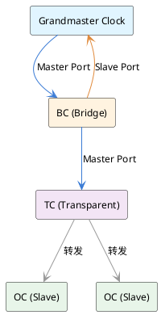
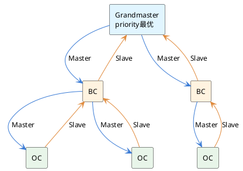
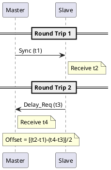
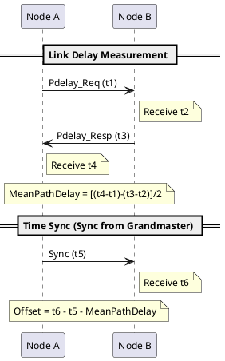
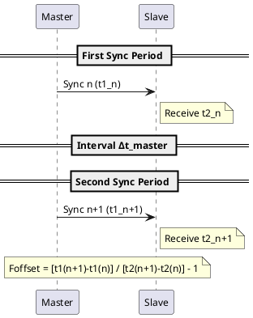

## 1 前言

IEEE 1588-2008（PTPv2）定义了精密时间同步协议，在以太网上实现亚微秒级精度的时间同步。相比NTP的毫秒级精度，PTPv2通过硬件时间戳消除了软件处理时延，使高精度应用（工业控制、电力系统、金融交易）成为可能。从2002年的v1发展到2008年的v2，增加了硬件时间戳支持、Transparent Clock机制和点对点（P2P）同步模式，大幅提升了网络环境下的同步精度。

现有的[linuxptp源码分析]()覆盖了实现细节，[linuxptp部署]()讲述了现网配置。本文补充协议理论——同步的对象、时钟节点的分类、主从关系如何建立以及具体的同步算法。

## 2 同步什么：频率同步与时间同步

频率同步（frequency synchronization）指两个时钟在恒定的相位差条件下，保持相同的节拍速率。比喻为两块手表，指针运行速度相同，但指示的时刻有固定的差值。频率偏差为零时，两时钟的计数间隔相同；有偏差时，一个计数快，一个计数慢。

时间同步（time synchronization）要求两个时钟的相位差为零，即指示的时刻一致。仍用手表比喻，两表指针指向同一时刻。时间同步必须建立在频率同步的基础上——如果两表运速不同，即使某时刻对齐，下一刻就会偏离。因此，时间同步包含两个层次：通过频率同步保证长期稳定性，再通过时间偏差补偿实现即时对齐。

PTPv2通过周期性报文交互实现这两层同步。报文中的时间戳用于计算频率比和时间偏差，设备时钟则通过偏差反馈和频率调整不断逼近主时钟。

## 3 时钟节点类型

PTPv2网络中的三类基本时钟节点：

- **OC（Ordinary Clock）**：单端口设备，可作为主时钟或从时钟，但不转发报文。
- **BC（Boundary Clock）**：多端口设备，一个从端口（slave port）与上层时钟同步，其余主端口（master port）向下游传播同步。BC既是主也是从，充当中间转换器。
- **TC（Transparent Clock）**：多端口，只转发报文，自身不同步。TC通过修正报文中的时延字段来补偿转发延迟，使下游设备能准确计算链路时延。

TC有两个工作模式。E2E TC（End-to-End Transparent Clock）修正转发驻留时间，使主从两端的OC或BC能从端到端的视角测量总链路时延；P2P TC（Peer-to-Peer Transparent Clock）修正每条直连链路的驻留时间，两端设备只需计算相邻链路时延，逐跳累加。

## 4 主从层次建立：BMC算法

Best Master Clock（BMC）算法通过Announce报文自动选举网络中最优的主时钟。每个设备周期性发送Announce报文，其中携带本设备的时钟源信息：clockClass（时钟等级，如铷钟、铯钟等）、clockAccuracy（精度）、offsetScaledLogVariance（偏差）和priority1/priority2（优先级）。

网络中所有设备按照定义的规则比较这些属性，选出综合指标最优的作为Grandmaster（根主时钟）。比较优先级依次为：priority1 → clockClass → clockAccuracy → offsetScaledLogVariance → priority2。较低的数值表示更优。

BMC算法的执行结果是确定每个端口的状态。选举过程中，获胜的端口变为Master Port（发送Sync），竞争失败的端口变为Slave Port（接收Sync进行同步）或Passive Port（收听但不响应）。网络拓扑收敛后形成以Grandmaster为根的生成树（spanning tree），保证无环并完整连接。

BMC的动态特性使其能应对网络变化。当Grandmaster故障、链路中断或新设备加入时，算法重新运行，重选主时钟并调整树形拓扑。这种自适应性是PTPv2的关键优势。

## 5 同步机制与报文

### 5.1 E2E机制

End-to-End同步模式下，Master和Slave间直接测量总链路时延，不经Transparent Clock。四条关键报文定义了同步过程：

- **t1**：Master发送Sync报文时的本地时间戳（master端离开时间）
- **t2**：Slave接收Sync报文时的本地时间戳（slave端到达时间）
- **t3**：Slave发送Delay_Req报文时的本地时间戳（slave端离开时间）
- **t4**：Master接收Delay_Req报文时的本地时间戳（master端到达时间）

在单步模式（one-step）下，Sync报文本身包含t1；在双步模式（two-step）下，Sync之后跟随Follow_Up报文携带t1。Delay_Resp报文返回t4。Master和Slave通过这四个时间戳计算网络延迟和时间偏差。

假设链路延迟对称（往返时间相等），时间偏差（offset）为：

`Offset = [(t2 - t1) - (t4 - t3)] / 2`

这个公式的含义是：(t2 - t1)是Sync的单向延迟加偏差，(t4 - t3)是Delay_Req的单向延迟。两者相减去掉延迟，再除以2是因为两个方向延迟相同。当链路不对称时，这个偏差会产生残留误差，需要更复杂的补偿策略。

### 5.2 P2P机制

Peer-to-Peer模式用于Transparent Clock的网络。每对相邻设备独立测量直连链路延迟，而不依赖端到端的往返测量。三条报文完成链路延迟测量：

- **t1**：Node A发送Pdelay_Req时的时间戳（A端离开）
- **t2**：Node B接收Pdelay_Req时的时间戳（B端到达）
- **t3**：Node B发送Pdelay_Resp时的时间戳（B端离开）
- **t4**：Node A接收Pdelay_Resp时的时间戳（A端到达）

链路延迟（MeanPathDelay）为：

`MeanPathDelay = [(t4 - t1) - (t3 - t2)] / 2`

这个延迟一旦测得，后续的时间同步通过Master的Sync报文完成。Master在Sync报文中携带发送时刻t5。Slave接收Sync报文，记录本地接收时刻t6，再减去累积的MeanPathDelay（逐跳加和）得到时间偏差：

`Offset = t6 - t5 - MeanPathDelay`

其中t5是Sync报文中Master的发送时间戳，t6是Slave接收Sync报文的本地时间。P2P模式的优势在于：链路延迟一次测得后可重复使用，无需每次同步都往返测量，且当主从关系变化时不需重新计算全局延迟。

E2E和P2P对比：E2E测量端到端总时延，适合没有Transparent Clock的简单网络；P2P逐点测量链路时延，在多级跳转或TC存在时更精确。两种模式的报文类型完全不同，协议在初始化时选择一种，不能混用。

## 6 时间同步与频率同步

### 6.1 时间同步

时间同步就是计算并消除时间偏差的过程。第5节描述的E2E和P2P机制通过四个时间戳计算Offset，设备收到同步结果后调整本地时钟，使其逼近Master时钟。这种调整既包括跳跃修正（一次性消除大偏差），也包括逐步调整（PPM级微调），取决于偏差大小和实现策略。时间同步是一个持续的反馈循环——Master周期性发送报文，Slave周期性接收并计算偏差，时钟驱动逐步收敛。

### 6.2 频率同步

频率同步通过连续的Sync报文完成。Master周期性发送Sync报文（默认每秒发送128次），每个Sync携带发送时的时间戳t1。Slave接收连续的Sync报文，记录其中的t1值和本地接收时间t2。对比两个连续Sync周期的时间差，可以计算Master和Slave时钟的速率比：

`Foffset = [t1(n) - t1(n-1)] / [t2(n) - t2(n-1)] - 1`

若Foffset为正，说明Slave时钟慢（时间流逝快），需要调快；若为负，说明Slave快（时间流逝慢），需要调慢。设备通过调整时钟的频率补偿，使Foffset逐渐趋向于零。频率同步建立后，偏差变化减慢，时间同步也就更容易维持。

## references

1. Huawei — 什么是1588v2 — https://info.support.huawei.com/info-finder/encyclopedia/zh/1588v2.html
2. IEEE1588V1-V2理解 — https://www.jianshu.com/p/e3552b8210fc
3. IEEE Std 1588-2008 — https://standards.ieee.org/ieee/1588/2522/
