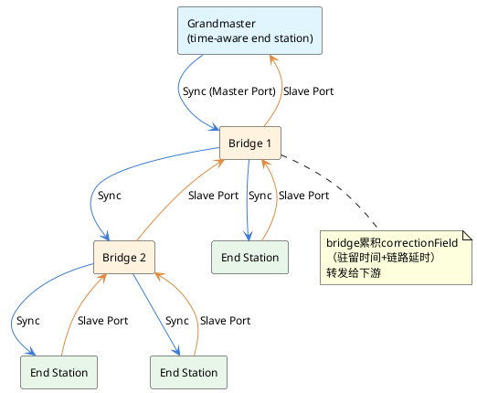
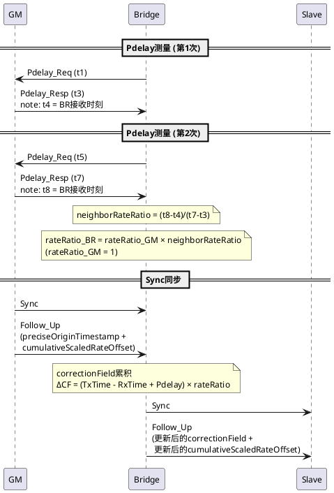

## 1 前言

gPTP（generalized Precision Time Protocol）是IEEE 802.1AS标准定义的时间同步协议，面向时间敏感网络（TSN）场景。TSN要求网络中所有节点对时间达成共识，才能实现确定性调度的流量整形、时间触发通信和故障诊断。gPTP脱胎于IEEE 1588（PTPv2），可视为PTPv2的一个profile——它收敛了PTPv2的可选项（传输层、延时测量方式、时钟类型、一步/两步法），用约束换确定性，在任意7跳以内节点间实现小于1µs的同步精度。

车载以太网是gPTP的典型应用场景。智能驾驶系统中，多个传感器（激光雷达、摄像头、毫米波雷达）的数据融合要求时间基准一致；域控制器之间的协同决策依赖时间触发调度。CAN总线时代，时间同步通过专用报文在总线上广播完成，精度足够但带宽受限。车载以太网引入后，带宽提升但交换机引入了非确定性延迟，传统的NTP（毫秒级）无法满足需求，gPTP在MAC层打硬件时间戳，将精度推到亚微秒级。

[PTPv2协议原理]()覆盖了PTPv2的同步对象、时钟节点分类、BMC算法和E2E/P2P同步机制。本文聚焦gPTP本身的工作方式，PTPv2已有的基础概念不重复。

## 2 gPTP概述

gPTP工作在OSI七层模型的第二层（数据链路层），以太网帧通过EtherType `0x88F7`标识gPTP报文，不经过IP层和UDP层。时间戳采样点放在MAC层与PHY层的边界——报文离开MAC进入PHY时打发送时间戳，报文离开PHY到达MAC时打接收时间戳。这个位置离物理介质只有一步，待补偿的延迟要么固定（可校准）要么对称（可抵消）。如果采样点在传输层，报文要经历协议栈排队、上下文切换和中断处理，延迟波动在微秒量级，直接吃掉gPTP的目标精度。gPTP强制使用硬件时间戳，PTPv2允许软件时间戳。

gPTP网络中有两类设备：

- **time-aware end station**：单端口终端设备，可作为grandmaster提供时钟基准，也可作为slave接收同步。对应PTPv2的OC（Ordinary Clock）。
- **time-aware bridge**：多端口桥接设备，一个从端口与上游同步，其余主端口向下游转发。对应PTPv2的BC（Boundary Clock），但行为被严格定义——它测量驻留时间和链路延时，在correctionField中累积，数学上等价于P2P TC。

gPTP的一个硬性约束：网络中所有节点必须time-aware。普通交换机不允许出现在gPTP路径上——它无法测量驻留时间，correctionField累积链就断了。节点通过Pdelay_Req探测邻居，如果对端不响应或延迟超过阈值，该端口被标记为"not AS capable"并排除在同步树之外。

## 3 网络结构与主时钟选择

gPTP网络以grandmaster为根形成时间同步生成树。grandmaster是系统中时钟精度最高的节点，其时钟源可以是GPS/北斗、原子钟或外部PTP域。grandmaster沿主端口向下发送Sync报文，bridge接收后修正correctionField再从主端口转发，直到所有末端end station。

grandmaster的确定有两种方式。动态选择通过BMCA（Best Master Clock Algorithm）完成：所有节点周期性发送Announce报文，携带自身的时钟参数（priority1、clockClass、clockAccuracy、offsetScaledLogVariance、priority2、clockIdentity），按优先级向量逐项比较，选出最优节点作为grandmaster。BMCA同时确定每个端口的角色——master、slave或passive，收敛后形成无环的生成树。

车载应用中网络拓扑固定，一般不使用动态BMCA，而是静态配置grandmaster和端口角色，避免启动阶段的竞选过程。

## 4 时间同步机制

gPTP的时间同步解决三类偏差：时钟偏差（节点上电后时钟初始值不同）、传输延迟（报文经过链路和bridge引入的延迟）、频率偏差（各节点晶振频率不同步）。

### 4.1 时钟偏差测量

grandmaster的主端口发送Sync报文，从端口记录接收时刻t2。gPTP强制使用两步法——Sync报文本身不携带时间戳，紧随其后的Follow_Up报文携带grandmaster发送Sync的精确时刻t1。从端口计算时钟偏差：

`Offset = t2 - t1 - pathDelay`

其中pathDelay是Sync报文从grandmaster到本节点累积的总路径延时。PTPv2允许一步法（one-step，Sync报文发送时由硬件实时填充t1），gPTP不允许。一步法要求PHY层支持on-the-fly打戳，硬件成本高；车载ECU能力差异大，两步法是更现实的选择。

### 4.2 传输延迟测量

gPTP强制使用P2P（Peer-to-Peer）延时测量，测量每对相邻节点之间的直连链路延时，不测量端到端总延时。Pdelay机制通过三条报文完成：Pdelay_Req、Pdelay_Resp、Pdelay_Resp_Follow_Up，产生四个时间戳（t1/t2/t3/t4），链路延时计算公式与PTPv2的P2P机制相同（详见[PTPv2协议原理]()的5.2节）。

gPTP禁用E2E（End-to-End）延时测量。E2E模式下普通交换机的驻留时间被包含在端到端总延时中，无法分离和补偿；P2P模式下每跳的驻留时间和链路延时都可独立测量。P2P的另一个优势是链路延时测量与主从关系无关——主从关系变化时（grandmaster故障、BMCA重选），各链路的Pdelay测量值仍然有效，无需重新测量。

### 4.3 频率同步

gPTP强制频率同步，且方式比PTPv2更直接。PTPv2的频率同步是可选的，通过连续Sync报文的时间戳差值间接计算频率比。gPTP通过neighborRateRatio逐跳测量相邻节点的频率比。

neighborRateRatio复用Pdelay测量过程。两次Pdelay测量产生四个时间戳，对端的发送时间戳差值(t7-t3)与本端的接收时间戳差值(t8-t4)的比值即为neighborRateRatio：

`neighborRateRatio = (t8 - t4) / (t7 - t3)`

如果两端频率一致，比值为1。频率比是逐跳累积的——从grandmaster到任意节点i，累积频率比为路径上各跳neighborRateRatio的乘积：

`rateRatio_i = rateRatio_{i-1} × neighborRateRatio_i`

累积频率比通过Follow_Up报文中的`cumulativeScaledRateOffset`字段传递，值为`(rateRatio - 1.0) × 2^41`的定点数。每个bridge收到上游的累积值后乘以自己的neighborRateRatio更新该字段并转发，下游节点直接读取。

## 5 correctionField累积

gPTP的Sync报文携带两个字段传递时间信息：`preciseOriginTimestamp`（grandmaster发送Sync的时刻）和`correctionField`（从grandmaster到当前节点的累积延时补偿）。从端口计算本地时钟偏差时：

`Offset = preciseOriginTimestamp + correctionField + pathDelay - localRxTime`

correctionField由每个bridge逐跳累积，包含两部分：报文在本bridge的驻留时间（TxTime - RxTime），以及上游链路延时。由于驻留时间在本端频率域测得，而correctionField在grandmaster频率域累积，增量计算需要做频率域转换：

`ΔCF = (TxTime - RxTime + neighborPdelay / neighborRateRatio) × rateRatio`

其中`neighborPdelay / neighborRateRatio`将链路延时从对端频率域转换到本端频率域，再乘以rateRatio转换到grandmaster频率域。所有计算在grandmaster频率域下进行，保证累积值的一致性。

correctionField以纳秒为单位，用`ns × 2^16`的定点数表示，支持亚纳秒精度。例如2.5ns存储为`0x0000000000028000`。PTPv2中只有Transparent Clock修正correctionField，gPTP中每个bridge都必须累积。

## 6 gPTP报文

gPTP使用PTPv2报文的一个子集，分为事件型和通用型：

- **事件型**（打硬件时间戳）：Sync、Pdelay_Req、Pdelay_Resp
- **通用型**（不打时间戳）：Follow_Up、Pdelay_Resp_Follow_Up、Announce、Signaling

gPTP不使用PTPv2的Delay_Req和Delay_Resp（E2E机制的报文），也不使用Management消息。

报文通过以太网多播地址`01-80-C2-00-00-0E`发送。虽然使用多播地址，gPTP报文不会被普通交换机转发——每个bridge接收后处理、修正correctionField，再从下游端口发出。gPTP报文不允许携带VLAN标签或优先级标签，但要求传输优先级高于best-effort流量，避免突发流量占用带宽导致同步报文超时。

gPTP的报文头中，`transportSpecific`字段固定为`0x1`（标识802.1AS协议），`domainNumber`固定为`0`。`transportSpecific=0x1`将gPTP报文与普通PTPv2报文区分开。

默认报文发送间隔：

| 报文             | 默认间隔（log2秒） | 实际间隔 |
| ---------------- | ------------------ | -------- |
| Sync / Follow_Up | -3                 | 125ms    |
| Pdelay_Req       | 0                  | 1s       |
| Announce         | 0                  | 1s       |

## 7 与PTPv2的差异

gPTP是PTPv2的TSN profile，核心差异是收敛可选项、强制确定性。IEEE 802.1AS-2011 clause 7.5列出的差异：

| 维度            | PTPv2                                  | gPTP                                                                                         |
| --------------- | -------------------------------------- | -------------------------------------------------------------------------------------------- |
| 传输层          | UDP/IPv4、UDP/IPv6、Ethernet（三选一） | 仅Ethernet二层（EtherType `0x88F7`）                                                         |
| 时间戳采样      | 软件或硬件（可选）                     | 仅硬件时间戳（MAC层）                                                                        |
| 时钟类型        | OC、BC、E2E TC、P2P TC（四种）         | time-aware end station、time-aware bridge（两种）                                            |
| 延时测量        | E2E或P2P（可选）                       | 仅P2P（强制）                                                                                |
| 一步/两步法     | 一步或两步（可选）                     | 仅两步法（强制）                                                                             |
| 非PTP设备透传   | 允许（精度下降）                       | 不允许（所有节点必须time-aware）                                                             |
| 频率同步        | 可选，间接                             | 强制，neighborRateRatio逐跳累积                                                              |
| correctionField | 仅TC修正                               | 每个bridge累积                                                                               |
| BMCA            | 完整1588 BMCA                          | 简化：无foreign-master qualification、无pre-master状态、无uncalibrated状态、所有节点强制参与 |
| 域数量          | 多域并行                               | 单域（2011版）                                                                               |
| 应用接口        | 不定义                                 | 形式化接口定义（clause 9）                                                                   |

## references

1. IEEE Std 802.1AS-2011 — IEEE Standard for Local and metropolitan area networks—Timing and Synchronization for Time-Sensitive Applications in Bridged Local Area Networks
2. IEEE Std 1588-2008 — IEEE Standard for a Precision Clock Synchronization Protocol for Networked Measurement and Control Systems
3. gPTP由浅入深全解析 — https://zhuanlan.zhihu.com/p/455988582
4. gPTP，自动驾驶时间同步里的"有趣灵魂" — https://zhuanlan.zhihu.com/p/686642953
5. gPTP协议详解与应用 — https://blog.csdn.net/qq_41816308/article/details/133975594