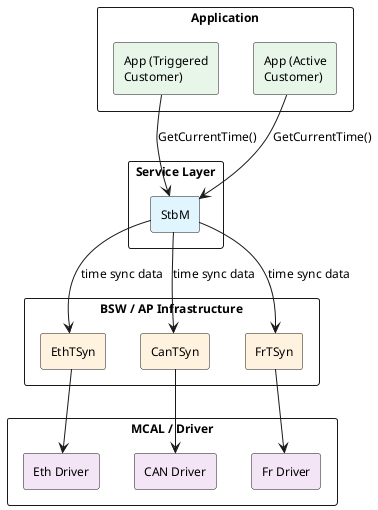
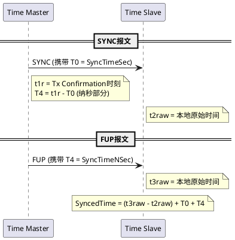

## 1 前言

gPTP（IEEE 802.1AS）定义了以太网上的时间同步协议，但车载系统的时间同步需求不止以太网——CAN、FlexRay总线上同样需要时间同步，应用程序还需要统一的API访问同步时间。AUTOSAR时间同步框架填补了这层空白：它在gPTP之上构建了软件栈，将时间同步从协议层延伸到应用层，同时支持多种总线传输。

[gPTP协议原理]()覆盖了gPTP的同步机制、correctionField累积和报文体系。本文聚焦AUTOSAR TimeSync的架构、对gPTP的扩展以及与gPTP的差异。

## 2 AUTOSAR TimeSync架构

AUTOSAR时间同步的核心是StbM（Synchronized Time-base Manager，同步时基管理器）。StbM向应用层提供统一的时间访问接口，向下通过总线特定的同步模块获取时间信息。整个架构分为三层：

- **StbM**：管理同步时基，提供全局时间给应用，处理时间校正（rate correction + offset correction）
- **总线同步模块**：CanTSyn（CAN时间同步）、EthTSyn（以太网时间同步）、FrTSyn（FlexRay时间同步），每种总线有独立的同步协议
- **TSP（Time Synchronization Provider）**：总线特定的时间同步提供者，为StbM抽象底层协议差异

Classic Platform（CP）和Adaptive Platform（AP）的架构层次一致，差异在API风格：CP通过C函数接口（`StbM_GetCurrentTime`等）访问，AP通过C++类（`SynchronizedTimeBaseConsumer`/`SynchronizedTimeBaseProvider`）访问，API设计遵循`std::chrono`风格。

StbM管理两类时基：

- **Synchronized Master Time Base**：主时基，由Global Time Master提供，是整个Time Domain的时间基准源
- **Synchronized Slave Time Base**：从时基，从上游Time Master或Time Gateway同步

Time Domain中的节点角色分三种：Global Time Master（全局时间基准拥有者）、Time Gateway（既是上游的从时钟又是下游的主时钟，类似gPTP的bridge）、Time Slave（被同步的从时钟）。

## 3 多总线时间同步

AUTOSAR TimeSync支持多种总线传输，每种总线有独立的同步模块，但都通过StbM向上提供统一的时基接口。时间从Global Time Master分发到Time Slave的流程如下图所示：

{:style="width: 80%; height: auto;"}

上图来自AUTOSAR AP SWS R24-11 Figure 7.1。

**Time Master侧**：

- **Time Base Reference Clock**：硬件晶振，时间基准的物理源头
- **Global Time Base Raw**：由Reference Clock驱动的原始时间，通过Software Counter消除溢出跳变
- **Global Time Base per Time Domain**：按Time Domain组织的主时基，应用可读写
- **Time Stamp → Global Time Synchronized / Offset**：取时间戳处理后，通过TimesyncMsg发送

**Time Slave侧**：

- 收到Global Time Synchronized / Offset后，与本地时间戳做⊕运算（补偿传输延迟和频率偏差）
- 结果写入Local Time Base Raw → Local Time Base per Time Domain，应用只读
- Slave同样有本地Reference Clock作为计时基准，收到同步报文后自动校正本地时基

TimesyncMsg的具体报文格式和传输机制取决于底层总线。

以太网传输通过EthTSyn实现，基于gPTP（IEEE 802.1AS），复用Sync/Follow_Up/Pdelay_Req/Pdelay_Resp/Pdelay_Resp_Follow_Up报文和P2P延时测量机制。同步流程与[gPTP协议原理]()描述的一致——Time Master发送Sync+Follow_up，bridge累积correctionField，Pdelay逐跳测量链路延时。AUTOSAR PRS TimeSyncProtocol标准明确指出：以太网时间同步使用IEEE 802.1AS定义的机制，但增加了针对车载场景的扩展和约束。

CAN总线通过CanTSyn实现时间同步。CAN没有硬件时间戳支持，仲裁机制和BSW延迟使报文发送时刻不可预测。CanTSyn采用软件时间戳的两步法：Time Master先发SYNC报文携带T0的秒部分，报文实际上线时通过Tx Confirmation获取精确发送时刻t1r，计算T0到t1r的差值T4（纳秒部分），再发FUP报文携带T4。Time Slave收到SYNC时记录本地原始时间t2raw，收到FUP时记录本地原始时间t3raw，计算同步时间：

`SyncedTime = (t3raw - t2raw) + T0 + T4`

其中T0+T4是Time Master发送SYNC时的精确全局时间，t3raw-t2raw是Time Slave从收到SYNC到收到FUP之间流逝的本地时间——这段时间内Time Slave用本地时钟计时，相当于将全局时间基准"推进"到FUP到达时刻。CanTSyn不测量往返延迟——CAN总线较短，传输延迟可忽略或静态配置。

FlexRay通过FrTSyn实现，机制与CanTSyn类似，同样采用两步法SYNC/FUP。AUTOSAR还通过CDD（Complex Device Driver）支持其他外设的时间同步。

## 4 AUTOSAR对gPTP的扩展

### 4.1 静态配置消除动态机制

AUTOSAR PRS标准指出车载以太网与商用以太网的两个关键差异：ECU角色预定义、网络拓扑静态。基于这两点，AUTOSAR消除了gPTP中的动态机制：

- **BMCA禁用**：gPTP保留了简化版BMCA（无foreign-master qualification），AUTOSAR直接静态配置Global Time Master，不运行任何竞选算法
- **Pdelay可省略**：gPTP强制周期性Pdelay测量；AUTOSAR允许在静态网络中省略周期性链路延时测量，因为线缆长度和节点位置不变

### 4.2 AUTOSAR TLV扩展

AUTOSAR在Follow_Up报文中扩展了TLV（Type-Length-Value），使用IEEE分配的CID `0x1A75FB`。TLV包含多个Sub-TLV：

| Sub-TLV                        | 内容       | 说明                         |
| ------------------------------ | ---------- | ---------------------------- |
| Time Secured / Not Secured     | 全局时间戳 | 携带CRC保护的时间值          |
| Status Secured / Not Secured   | 时基状态   | 同步状态、精度信息           |
| UserData Secured / Not Secured | 用户数据   | 应用自定义数据，gPTP无此能力 |
| OFS Secured / Not Secured      | 偏移量     | Offset Time Base的偏移值     |

"Secured"变体携带CRC校验，"Not Secured"变体不携带。CRC覆盖Sub-TLV的payload，确保时间同步报文的完整性。gPTP不定义任何安全机制。

UserData是AUTOSAR特有的扩展——应用可以在时间同步报文中携带自定义数据（如传感器元信息），随时间戳一起分发到网络中所有节点。

### 4.3 SGW与安全时间同步

SGW（Secure Gateway）值在AUTOSAR TLV中传递，用于Time Slave验证时间源的新鲜度。AP SWS R24-11定义了Secure Time Synchronization功能：Time Master在发送时间戳时附加Freshness value，Time Slave验证Freshness后才接受时间更新。这防止重放攻击——攻击者即使截获时间同步报文，也无法用过期报文欺骗Time Slave。

gPTP没有任何安全机制，不验证报文来源和新鲜度。

## 5 时间校正机制

StbM的时间校正不修改本地硬件时钟，而是在读取时钟值时动态修正。硬件时钟（晶振计数器）自由运行，StbM在其上构建Virtual Local Time——通过Software Counter记录硬件计数器溢出，消除跳变。

校正分两层：

- **Rate Correction**：校正频率偏差。gPTP的neighborRateRatio复用Pdelay测量过程的时间戳计算频率比，AUTOSAR通过Sync报文的时间戳差值计算Rate Deviation，Pdelay-based Rate Correction是可选的。Rate Correction Factor接近1.0，乘以Virtual Local Time得到校正后的时间。gPTP在协议层逐跳累积频率比，StbM在应用层统一校正。
- **Offset Correction**：校正绝对时间偏差。Time Slave收到Sync报文后计算本地时间与全局时间的偏差，逐步调整（不是跳跃式修正），避免时间回退。

校正过程在`StbM_GetCurrentTime()`调用时实时计算——应用每次读取时间，StbM将Virtual Local Time乘以Rate Correction Factor，加上Offset Correction，返回校正后的同步时间。

## 6 AP TimeSync API

Adaptive Platform通过`ara::tsync`命名空间提供C++ API。核心类两个：

- `SynchronizedTimeBaseProvider`：时基提供者，Global Time Master节点使用。调用`SetTime()`更新时基并触发网络发送，调用`UpdateTime()`仅更新本地时基不触发发送
- `SynchronizedTimeBaseConsumer`：时基消费者，Time Slave节点使用。调用`GetCurrentTime()`获取同步时间，调用`GetTimeWithStatus()`获取带状态信息的时间

AP的TimeSync功能由守护进程`rb-tsyncd`实现，管理包含时基配置的共享内存区域。以太网传输通过`rb-aptpd2`进程实现PTP协议栈，与`rb-tsyncd`交互更新时基。应用通过链接`librb-tsync.so`库访问时间同步功能。

配置通过ARXML文件定义`TimeSyncModuleInstantiation`，包含Time Bases（Provider或Consumer类型），每个引用对应的Global Time Eth Master/Slave作为网络时间提供者。

## 7 与gPTP的差异

AUTOSAR TimeSync不是gPTP的替代品，而是在gPTP之上构建的应用层框架。以太网传输层仍使用gPTP协议，但AUTOSAR增加了软件栈、多总线支持、安全机制和应用接口。

| 维度               | gPTP（IEEE 802.1AS）            | AUTOSAR TimeSync                          |
| ------------------ | ------------------------------- | ----------------------------------------- |
| 定位               | L2协议                          | 应用层框架（含StbM + 总线同步模块）       |
| 传输介质           | 仅以太网                        | 以太网、CAN、FlexRay、CDD                 |
| 主时钟选择         | 简化BMCA（可选）                | 静态配置，无BMCA                          |
| Announce/Signaling | 使用                            | 不支持                                    |
| 链路延时测量       | 强制周期性Pdelay                | 可省略（静态网络）                        |
| 频率校正           | neighborRateRatio复用Pdelay测量 | 通过Sync报文时间戳计算，Pdelay可选        |
| 安全机制           | 无                              | CRC + Freshness value + Secure TLV        |
| 用户数据           | 不支持                          | UserData Sub-TLV                          |
| 时间校正           | 协议层逐跳累积                  | 应用层Rate Correction + Offset Correction |
| 报文扩展           | 无                              | AUTOSAR TLV（CID 0x1A75FB）               |
| CAN支持            | 不支持                          | CanTSyn两步法SYNC/FUP                     |
| Time Gateway       | time-aware bridge               | Time Gateway（CP支持，AP暂不支持）        |

## references

1. AUTOSAR PRS TimeSyncProtocol R19-11 — Time Synchronization Protocol Specification
2. AUTOSAR AP SWS TimeSynchronization R24-11 — Specification of Time Synchronization
3. AUTOSAR SWS TimeSyncOverCAN R21-11 — Specification of Time Synchronization over CAN
4. AUTOSAR概述 & 基于AUTOSAR的时间同步 — https://www.cnblogs.com/macro-c/p/15562628.html
5. Adaptive AUTOSAR学习笔记16 - 时间同步和网络管理 — https://www.cnblogs.com/tengzijian/p/15221138.html
6. AP AUTOSAR硬核技术：时间同步TimeSync — http://www.uml.org.cn/car/202304171.asp
7. Autosar Time Sync时间同步 — https://blog.csdn.net/king110108/article/details/125111388