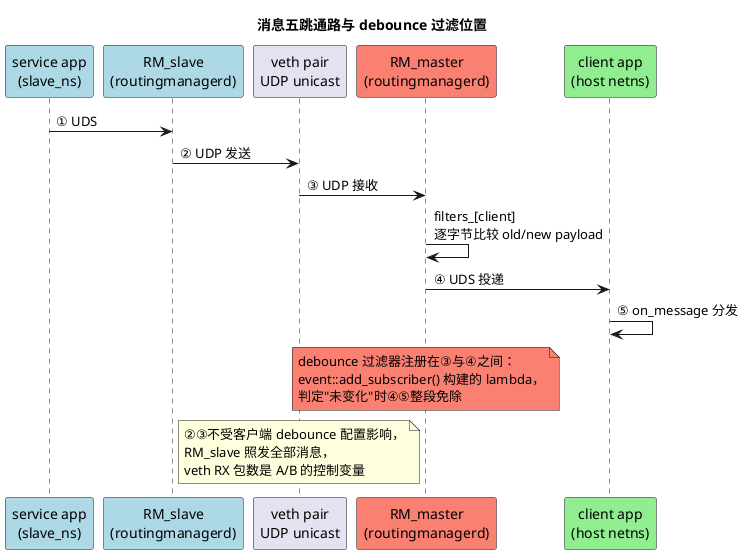

## 1 前言

前篇[vsomeip test-veth虚拟以太网配置和运行vsomeip官方测试]()把`vsomeip/test/network_tests/debounce_tests`跑了起来，并拆解了它的过滤机制：客户端json里的`debounce`配置（`on_change`+`ignore`/`mask`内容过滤）注册在接收侧的routingmanagerd（host侧的称RM_master，slave侧的称RM_slave）上，`event::add_subscriber()`为每个订阅者构建一个payload比较lambda，被判定"未变化"的事件不会投递给应用。

这套机制对资源的实际影响需要量化回答三个问题：省了多少CPU、省在哪个环节、过滤本身付出多少成本。本文用A/B对比实验加perf采样测量，负载为5000条/约7秒的事件通知。结论先行：

- client进程CPU从约15%单核降到约0（-99.9%）；
- RM_master CPU下降42%，而过滤本身只花12%；
- 网络链路流量零节省——过滤发生在收包之后，省的是"收下来之后"的一切。

实验环境承接前篇：单机veth+netns模拟双机，拓扑与搭建命令见前文。测量机只有无线网卡，perf版本6.8.12，`kernel.perf_event_paranoid=4`（内核限制perf权限的等级，此值下非root完全不可用），所有perf命令必须加sudo。文中全部数据来自`results_A_ignored/`、`results_B_ignored/`目录下的perf stat与perf report原始输出。

## 2 debounce_tests回顾

### 2.1 与debounce_callback_tests的区别

`network_tests`里有两个debounce相关的测试，过滤维度不同：

|          | debounce_tests（本篇）               | debounce_callback_tests                                    |
| -------- | ------------------------------------ | ---------------------------------------------------------- |
| 过滤类型 | 内容过滤：on_change+ignore/mask      | 时间过滤：interval（2000/3000ms）+send_current_value_after |
| 配置位置 | 客户端json（过滤在master侧RM）       | 客户端json（过滤在master侧RM）                             |
| 子测试   | flat/increase/decrease/mask共4个     | 1个，23秒时序剧本                                          |
| 期望校验 | 每测试预置5~6条期望payload，逐条比对 | 14条期望序列，顺序比对                                     |

两者都是"客户端配置→接收侧RM过滤"的模式，收益模型相同，差别只在过滤算法。本篇测量的是内容过滤这一支。

### 2.2 四个子测试的过滤语义

service以0xb657/0x0003offer三个FIELD事件（字段状态的通知，事件号0x8001/0x8002/0x8004），每个子测试发10条notify，客户端过滤后期望收到5~6条。flat子测试在事件0x8001上配置ignore字节[0,5]，字节0/5任意变化视为未变化，10条只转发5条；increase/decrease子测试在0x8002上配置ignore[0,5,7,8,9,10]，payload长度逐条递增/递减，考察长度变化与ignore的交互；mask子测试在0x8004上带位掩码（index 0 mask 0x0f、index 5 mask 0xfe），被mask掉的位变化不算变化。

old/new payload逐字节比较的内部逻辑（ignore跳过、partial mask按`~mask`位比较）就是前篇拆解的`event::add_subscriber()`构建的filters lambda，此处不再重复；本篇的perf diff会在热点里再次见到这个lambda。

## 3 数据通路与收益模型

消息从service到client共五跳，其中①④是同机的UDS（Unix Domain Socket，本地套接字IPC），②③是跨netns的UDP单播：



debounce过滤器站在第④跳的入口上，过滤判定发生在③收包完成之后、④投递之前。据此推出三个可被数据检验的假设：

1. 网络链路（②③）零节省：RM_slave感知不到客户端的过滤配置，照发全部消息，veth流量、UDP解析、软中断都不变；veth收发包数因此必须作为A/B实验的控制变量，两组不相同则实验没有控住；
2. 省的是④的UDS投递加⑤：每条被过滤的消息免掉RM_master的UDS序列化发送、client一次进程唤醒/上下文切换、payload拷贝和消息分发处理；
3. RM_master自身新增一次old/new payload比较：CPU持平或略升都属正常，不能作为"配置无效"的判据。

实测对照：假设1成立（两组veth RX包数一致）；假设2成立（client开销归零）；假设3过于保守——RM_master实际净省42%，省掉的转发开销远大于新增的比较开销，见第9章。

## 4 测量方案设计

### 4.1 A/B单变量对比

B组（去抖）直接使用现有`debounce_test_client.json`；A组（基线）将其拷贝为`debounce_test_client_nodebounce.json`，仅删除整个"debounce"段，unicast/network/service-discovery原样保留：

> // debounce_test_client.json（B组配置，节选事件0x8001）
```json
"debounce" :
[
    {
        "service" : "0xb657",
        "instance" : "0x0003",
        "events" :
        [
            {
                "event" : "0x8001",
                "on_change" : "true",
                "ignore" :
                [
                    0, 5
                ]
            }
        ]
    }
]
```

事件0x8002（ignore[0,5,7,8,9,10]）与0x8004（mask）同结构，不逐条列出。A组跑的时候用`VSOMEIP_CONFIGURATION`环境变量指向nodebounce json即可，不需要改官方的starter启动脚本。两组唯一的差别就是debounce段的有无，其余配置、负载、采样窗口完全一致。

### 4.2 负载放大

原测试4个场景各10条notify，瞬时发完，总CPU开销在毫秒量级，perf的采样噪声就能淹没信号。service侧追加压力负载：5000条notify、间隔1ms，约5秒、1000 msg/s，由环境变量`DEBOUNCE_STRESS=<count>`控制，默认关闭，不影响原有功能测试。

### 4.3 压力负载的两个变体

`DEBOUNCE_STRESS_MODE`选择payload的变化方式，对应两组测量意图：

| 变体    | payload变化方式           | 测量意图                                            |
| ------- | ------------------------- | --------------------------------------------------- |
| ignored | 只递增被ignore的第0字节   | 去抖组几乎全过滤（只转发首条），测过滤收益          |
| real    | 每条都改非ignore的第1字节 | 去抖组全转发但每条都要比payload，测过滤自身开销上界 |

本次实验完成的是ignored变体；real变体未跑，见第10章。

### 4.4 指标体系

测量围绕四类指标：veth_master的RX包数差值做控制变量校验（A/B两组必须相等）；client实收条数做去抖生效证据（B约6条、A约5010条）；client与RM_master的CPU占用做核心收益指标（`perf stat -p`按PID采样）；`perf record -F 99 -g`（每秒采样99次、记录调用栈）加`perf diff`对比两组热点分布。每组跑5轮取均值和标准差。

CPU占用取perf stat的三个事件：task-clock，任务实际占用CPU运行的时长，单位ms，等待和睡眠不累计；context-switches，内核记录到该任务的上下文切换次数，进程睡眠让出核与被唤醒重新调度都计入；cpu-migrations，任务在CPU核之间的迁移次数。第8章数据表把后两项分别缩写为ctx、mig。

## 5 源码改动

### 5.1 service侧：压力负载

`start_test()`的DTI_FLAT（flat子测试）分支末尾追加压力发送，环境变量控制，默认关闭：

```c++
// debounce_test_service.cpp
if (test_id_ == debounce_test_id_e::DTI_FLAT) {
    const char* its_stress = std::getenv("DEBOUNCE_STRESS");
    if (its_stress) {
        const int its_count = std::atoi(its_stress);
        const char* its_mode = std::getenv("DEBOUNCE_STRESS_MODE");
        const bool its_real_change
            = (its_mode && std::strcmp(its_mode, "real") == 0);

        VSOMEIP_INFO << "start_test: Sending " << std::dec << its_count
                << " stress messages (mode: "
                << (its_real_change ? "real" : "ignored") << ")";

        auto its_payload = vsomeip::runtime::get()->create_payload();
        for (int i = 0; i < its_count; i++) {
            const uint8_t its_v = static_cast<uint8_t>(i & 0xFF);
            its_payload->set_data({ static_cast<uint8_t>(its_real_change ? 0x00 : its_v),
                                    static_cast<uint8_t>(its_real_change ? its_v : 0x02),
                                    0x03, 0x04, 0x05, 0x06, 0x07 });
            app_->notify(DEBOUNCE_SERVICE, DEBOUNCE_INSTANCE,
                    DEBOUNCE_EVENT, its_payload);
            std::this_thread::sleep_for(std::chrono::milliseconds(1));
        }
        VSOMEIP_INFO << "start_test: Stress load done.";
    }
}
```

payload共7字节：ignored模式只递增第0字节（被ignore），real模式只改第1字节（非ignore）。两条`VSOMEIP_INFO`一条用来对齐perf采样窗口，一条用来校验负载完整性。

### 5.2 client侧：三处配套

压力模式下client的期望表只有5~6条，而基线组会收到全量消息，直接比对必然越界，几千条gtest失败输出还会污染测量。client做三处配套改动。

构造函数读`DEBOUNCE_STRESS`置`is_stress_`标志：

```c++
// debounce_test_client.cpp
debounce_test_client::debounce_test_client(debounce_test_id_e _test_id)
    : test_id_(_test_id),
      index_(0),
      is_available_(false),
      is_stress_(std::getenv("DEBOUNCE_STRESS") != nullptr),
      runner_(std::bind(&debounce_test_client::run, this)),
      app_(vsomeip::runtime::get()->create_application("debounce_test_client")) {
}
```

`on_message`在压力模式下只做`index_++`计数、跳过EXPECT（gtest断言）比对：

```c++
// debounce_test_client.cpp
// In stress mode only count the received messages, payload comparison
// is not possible as more messages arrive than expected payloads exist.
if (is_stress_
        && DEBOUNCE_SERVICE == _message->get_service()
        && (DEBOUNCE_EVENT == _message->get_method()
            || DEBOUNCE_EVENT_2 == _message->get_method()
            || DEBOUNCE_EVENT_4 == _message->get_method())) {
    index_++;
    return;
}
```

订阅窗口从固定等待2秒改为压力模式下睡满整个负载窗口（count+3000ms余量），保证client在负载期间保持订阅——提前STOP会截断负载，见7.2节：

```c++
// debounce_test_client.cpp
if (is_stress_) {
    // Keep the subscription alive for the whole stress window
    // (load duration + margin for transmission and processing).
    std::this_thread::sleep_for(
            std::chrono::milliseconds(
                    std::atoi(std::getenv("DEBOUNCE_STRESS")) + 3000));
}
```

`compare_payload`加越界保护，index超出期望表长度直接返回false，基线模式收全量消息时不会崩：

```c++
// debounce_test_client.cpp
bool
debounce_test_client::compare_payload(
        const std::shared_ptr<vsomeip::payload> &_payload,
        std::size_t _index) const {
    if (test_id_ >= payloads__.size()
            || _index >= payloads__[test_id_].size())
        return false;

    auto its_expected_payload = payloads__[test_id_][_index];
    // ...逐字节比对
}
```

测试结束打印实收计数：

```c++
// debounce_test_client.cpp
VSOMEIP_INFO << __func__ << ": Received " << std::dec << index_ << " messages.";
```

这行日志就是去抖生效的定量证据——B组整个窗口只收到6条。

## 6 测量脚本debounce_bench.sh

脚本放`test/network_tests/debounce_tests/`下，同步拷贝到build目录运行：

```bash
sudo ./debounce_bench.sh <A|B> [runs=5] [stress_count=5000] [ignored|real]
```

每轮流程六步：

1. 清理残留`/tmp/vsomeip_*`与测试进程；
2. 记录veth_master RX包数初值；
3. netns侧起RM_slave和service（带DEBOUNCE_STRESS）；
4. host侧起RM_master和client（带DEBOUNCE_STRESS，组别决定client json：A组nodebounce、B组原配置）；
5. grep轮询service日志的"stress messages"标记，出现后启动两个`perf stat -p`（窗口=count/1000+2秒），末轮追加`perf record -F 99 -g`；
6. 等client退出，记录RX差值与实收条数，kill全部进程，冷却2秒进入下一轮。

对齐采样窗口的核心片段：

```bash
# debounce_bench.sh
# wait until the stress load starts, then measure for its duration
for t in $(seq 1 200); do
    grep -q "stress messages" "$RES/run${i}_service.log" && break
    sleep 0.2
done
WINDOW=$((COUNT / 1000 + 2))

perf stat -p "$RM_PID" -o "$RES/run${i}_rm.stat" -- sleep "$WINDOW" &
perf stat -p "$CLIENT_PID" -o "$RES/run${i}_client.stat" -- sleep "$WINDOW" &
```

产出目录`results_<组>_<模式>/`：每轮的`runN_client.stat`、`runN_rm.stat`、`runN_client.log`、`runN_service.log`，末轮附加`<组>_client.data`与`<组>_rm.data`两个perf record数据文件。

## 7 踩坑记录

按遇到顺序记录。这些坑与vsomeip本身无关，属于多进程性能测量实验的通病，即使不做本实验也用得上。

### 7.1 日志块缓冲让窗口对齐失效

脚本靠grep service日志里的"stress messages"标记对齐perf采样窗口。vsomeip日志走std::cout，重定向到文件后是块缓冲，几KB才flush一次，标记行可能一直滞留缓冲区，grep等40秒超时后perf才启动——负载只有约5秒，窗口全部错过。终端直跑看不到这个问题，终端是行缓冲。修复是启动命令加`stdbuf -oL -eL`强制行缓冲。

### 7.2 环境变量单侧传递，负载被截断

第一版脚本只把`DEBOUNCE_STRESS`传给slave侧的service，master侧client没拿到：client按功能模式运行，flat期望5条却在收到第6条（压力首条）时报EXPECT失败；更糟的是client只睡2秒就发STOP，service提前停止，5000条压力只发出约2000条。多进程实验里协同环境变量必须逐侧检查是否传到；service日志里"Stress load done."是否出现是负载完整性的检查点。

### 7.3 perf附加竞态

`perf stat -p <pid>`偶发附加失败：目标PID在捕获与attach之间退出或异常，整个stat文件只有header，或所有事件显示`<not counted>`（伴随的NMI watchdog提示是误导）。B组run1/2的client、A组run1的RM_master中招。处理办法是不中断流程，跑完剔除坏样本（5轮取4轮均值）；根治要加PID有效性校验。

### 7.4 perf diff版本差异

Ubuntu 24.04的perf 6.8里perf diff没有`--stdio`选项（perf report才有），直接运行即为stdio输出。

### 7.5 前置坑

`kernel.perf_event_paranoid=4`下非root的perf完全不可用，一律sudo；源码目录的测试json是cmake configure_file的生成物，每次构建会被覆盖，实验用的配置改动要放build目录；双端json需要不同的`network`参数做UDS隔离，debounce_tests里的命名是交叉的——master侧client.json的network叫`vsomeip_slave`，slave侧service.json叫`vsomeip_master`，不影响功能但容易看晕；基线组收到的消息数远超期望表长度，越界保护必须先行。

## 8 实验数据

负载5000条stress（ignored模式）加4个功能测试，perf窗口7~9秒，每组5轮。表中RM列均指RM_master，ctx、mig的含义见4.4节。

### 8.1 A组（基线，无去抖）

| run | client task-clock | client ctx | client mig | client实收 | RM task-clock | RM ctx |
| --- | ----------------- | ---------- | ---------- | ---------- | ------------- | ------ |
| 1   | 1080.71 ms        | 19149      | 2033       | 5010       | （附加失败）  | —      |
| 2   | 1112.03 ms        | 19208      | 3059       | 5010       | 751.87 ms     | 12774  |
| 3   | 1071.93 ms        | 19453      | 3571       | 5010       | 736.04 ms     | 13160  |
| 4   | 1108.07 ms        | 19351      | 2881       | 5010       | 737.40 ms     | 12646  |
| 5   | 1109.83 ms        | 19589      | 2974       | 5010       | 750.23 ms     | 12693  |

4个gtest全部PASSED（压力计数模式跳过payload比对）。

### 8.2 B组（去抖）

| run | client task-clock | client ctx | client实收 | RM task-clock | RM ctx | 负载完整 |
| --- | ----------------- | ---------- | ---------- | ------------- | ------ | -------- |
| 1   | （附加失败）      | —          | 6          | 416.28 ms     | 9931   | ✓        |
| 2   | （附加失败）      | —          | 6          | 479.79 ms     | 9833   | ✓        |
| 3   | 0.04 ms           | 1          | 6          | 464.46 ms     | 9956   | ✓        |
| 4   | 0.02 ms           | 1          | 6          | 432.15 ms     | 9961   | ✓        |
| 5   | 0.01 ms           | 1          | 6          | 361.98 ms     | 10009  | ✓        |

4个gtest全部PASSED。client实收6条=5条功能消息加1条压力首条：flat末条功能消息后，压力首条payload里非ignore的下标4字节从0x01变为0x05，属于真实变化，被转发；后续4999条只有被ignore的字节0在变，全部被过滤。这个数字本身就是debounce语义正确性的证据。

### 8.3 汇总对比

| 指标（7s窗口）              | A基线                       | B去抖         | 节省              |
| --------------------------- | --------------------------- | ------------- | ----------------- |
| **client task-clock**       | 1096.5 ± 19 ms（约15%单核） | ≈ 0.02 ms     | **≈ 100%**        |
| **client context-switches** | 19350 ± 179                 | 1             | **≈ 100%**        |
| client cpu-migrations       | 2904                        | ≈ 0           | ≈ 100%            |
| **RM_master task-clock**    | 743.9 ± 8 ms（n=4）         | 430.9 ± 46 ms | **-42%**          |
| RM_master context-switches  | 12818 ± 234                 | 9938 ± 65     | -22%              |
| veth_master RX包数          | ≈ 5010                      | ≈ 5010        | 0（控制变量成立） |

## 9 数据分析

### 9.1 四个定量结论


client收益接近归零：基线下5010条消息每条一次UDS唤醒，约716次/秒的唤醒频率吃掉约15%单核、每秒约2760次上下文切换；去抖后client在整个窗口只醒一次。这是过滤发生在RM_master、下游全部免单的直接证据。

RM_master净省42%：省掉的是每条消息的UDS序列化发送加唤醒对端，新增的是payload逐字节比较。假设3的"持平或略升"判断过于保守。

网络侧零节省被证实：两组veth收包数一致（控制变量成立），这条链路的成本与客户端debounce配置无关。

单条消息的下游成本：A组总CPU（client加RM）减B组RM，(1096.5+743.9-430.9)≈1409 ms，除以5010条约0.28 ms CPU/条；上下文切换(19350+12818-9938)/5010≈4.4次/条。多订阅者、更大payload、更重的下游业务时，这两个数字按乘数放大。

### 9.2 perf diff热点解读（RM_master，A→B）

B组最大用户态热点是`routing_manager_base::register_event(...)::{lambda#2}::_M_invoke`，diff占比+12.41%——正是注册事件时构建的payload比较lambda（前篇拆解的filters lambda）。去抖的价格约12%的RM CPU，对比42%的净节省，收益远大于成本。

A组独占约13%的`[unknown] 0000000000000000`热区——无符号信息的地址，perf无法映射到函数名，推测是内联的拷贝/解析代码——B组消失。A组还独占一组转发路径符号：`pthread_mutex_lock`、`pthread_cond_signal`（唤醒等待线程）、`__tls_get_addr`（线程本地变量寻址）、`_Rb_tree_increment`（订阅/路由红黑树遍历）、`find_instance`（端点查找）——"查路由→UDS发送→唤醒client"这条链路的开销，B组归零。

B组占比上升的内核符号（futex、ttwu_queue_wakelist、datagram_poll、epoll_wait、psi_task_switch）不代表绝对开销变高：diff百分比是各自profile内的占比，B总CPU更小，"每包一次唤醒"的固定开销占比被放大。`__skb_recv_udp`在A组占10.65%，收包两组都在发生，与去抖无关。

### 9.3 client报表解读

A组client的perf report前40行全是`futex_wait → schedule → finish_task_switch`调用链：每条消息一次"睡眠→唤醒"循环，与19350次上下文切换完全对应。看用户态业务热点要加`--no-children`过滤掉内核睡眠链：

```bash
sudo perf report -i results_A_ignored/A_client.data --stdio --no-children | head -40
```

## 10 延伸

两个方向可以补测。若目标是省网络带宽或发送端负载，debounce应配置在service侧json（发送端过滤），收益模型完全不同——省的是②③的流量和两端协议栈开销，对应第二轮实验。real变体（全转发但每次都比对）测过滤自身开销上界，用来回答什么时候配debounce反而亏——消息几乎全是真变化时，比较开销白付，一条也省不下来。

## references

1. [vsomeip test-veth虚拟以太网配置和运行vsomeip官方测试]()——前篇，debounce_tests环境搭建与filters lambda拆解
2. [japric/vsomeip](https://github.com/japric/vsomeip/tree/vsomeip_demo)——测试代码与debounce实现所在仓库
